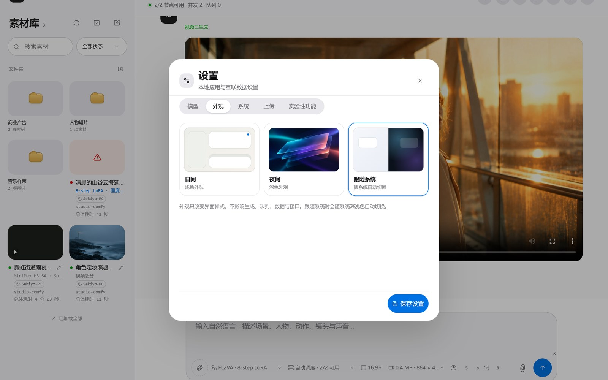
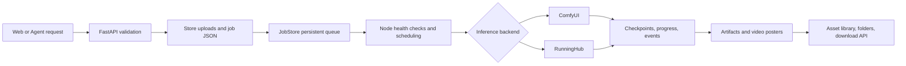

<div align="center">


# MiniMax H3 Studio

Unified control service for MiniMax H3 video, speech, Music3 and ComfyUI workflows

[](https://www.python.org/)
[](https://fastapi.tiangolo.com/)
[](https://github.com/Comfy-Org/ComfyUI)
[](https://huggingface.co/MiniMaxAI/MiniMax-H3)

[中文](README.md) | [English](README.en.md)

[Features](#features) · [Interface](#interface) · [Workflows](#workflows) · [Local ComfyUI](#local-comfyui) · [Data flow](#data-flow) · [Update log](#update-log) · [Deployment](#deployment) · [API](#api) · [Validation](#validation)

</div>

MiniMax H3 Studio provides one web interface, HTTP API, desktop entry and Android remote client for MiniMax H3, H3 TTS, digital human, Music3 and generic RunningHub workflows. The service handles request validation, reference uploads, a persistent queue, inference node scheduling, live events, task recovery, asset management and result delivery.


> [!IMPORTANT]
> This repository does not include model weights. Check the license terms of MiniMax H3, Music3, the LoRAs, ComfyUI and custom nodes before deploying.

## Features

| Area | Capability |
|---|---|
| Video generation | FL2VA, Ref2VA, 8-step LoRA, two-stage sampling, H3 SA, VDN H3, digital human and H3 NSFW |
| Audio generation | Music3 INT8 and H3 TTS with lyrics, style prompts and audio references |
| Long video | H3 SA splits at legal frame grids, carries context, trims duplicated frames and merges the result |
| VDN H3 | 8 to 50 steps with automatic DMD or B-stage selection |
| Job queue | Persistent queue, node scheduling, cancel, regenerate, checkpoint recovery and live progress |
| Total elapsed time | Measured from the moment an inference node starts the job; queue wait time is excluded |
| Asset library | Search, paging, status filters, cached video posters, preview, download and rename |
| Asset preview | Every asset opens in a preview dialog: images, a video player, audio as "file name + player", and unknown files with an unknown-file icon |
| Folders | Single-level folders, double-click to open, bulk move, an ungrouped root and deletion guards |
| Local assets | Capacity stats, 30-day video cleanup preview, ownership checks and artifact deletion |
| Detail windows | No backdrop blur, window shadows, several windows at once, independent drag and a collapsible detail sidebar |
| Node management | ComfyUI and RunningHub nodes, health checks, start/stop, concurrency and local/remote detection |
| Workflows | Built-in presets and custom ComfyUI workflows, field and reference mapping, result node selection, node sync and validation |
| Reference slots | Custom workflows declare `ref_images` / `ref_videos` / `ref_audios` slots by type and index, so uploads are no longer limited by the workflow's fixed node count |
| Run logs | Toolbar entry with a queue badge, a draggable dialog, live progress, and workflow sync/generation errors |
| Local ComfyUI | Experimental: launch and supervise a local ComfyUI from the app, with launch paths, private environments and process shutdown on exit |
| Themes | Switch between day, night and follow-system; themes only change visuals, never behaviour or data |
| Multi-device | LAN or Tailscale pairing, authorization revocation, proxied jobs and read-only remote assets |
| Android client | Phone and tablet remote client pinned to FL2VA FP8 + 8-step LoRA, supporting remote ComfyUI, RunningHub, multi-device, progress and downloads; Beta, not yet tested on devices |
| Agent access | Swagger UI, OpenAPI JSON, a public `AGENT.md` and Skill authoring rules |

The front end also supports asset library width dragging with `localStorage` persistence (capped at 50%), fixed card sizes, hidden scrollbars, page fill-in after resize, log artifact focusing and a tail-follow toggle for live logs.

> [!WARNING]
> The Android APK is Beta. It has only been built and statically checked; installation, connection, file picking and downloads have not been verified on a real phone or tablet.

## Interface

| Workbench | Aurora Glass skin |
|---|---|
|  |  |

| Workflow manager | Inference nodes |
|---|---|
|  |  |

| Run logs | Appearance and themes |
|---|---|
|  |  |

## Appearance and themes

Three appearance modes are available under Settings → Appearance and apply immediately:

| Mode | Behaviour |
|---|---|
| Day | Fixed light appearance |
| Night | Fixed dark appearance |
| Follow system | Reads `prefers-color-scheme` and switches live (default) |

The mode is stored in the browser's `h3-theme` key; an old `h3-skin` value migrates to day or night. Two skin styles keep implementing the visuals:

| Mode | Base skin | Style |
|---|---|---|
| Day | Meadow (default) | Apple-style light: light grey canvas, a single Action Blue, hairline separators and pill controls |
| Night | Aurora Glass | Dark glassmorphism: aurora backdrop, cyan and purple gradients, serif headings |
| Follow system | Automatic | Aurora Glass when the OS is dark, otherwise Meadow |

| Appearance settings | Night workbench |
|---|---|
|  |  |

Themes are presentation only: CSS overrides design tokens and decorative properties, never DOM structure, order, visibility, copy or JavaScript behaviour. Generation, queueing, assets, workflows and the API behave identically in all three modes.

### Type scale

All interface text uses ten steps exposed as `:root` `--text-*` tokens. New modules must not hardcode `font-size`; extend the tokens instead.

| Token | Size | Usage |
|---|---:|---|
| `--text-micro` | 10px | Uppercase section labels, badges |
| `--text-caption` | 11px | Metadata, helper text |
| `--text-small` | 12px | Secondary labels, control text |
| `--text-ui` | 13px | Forms, buttons, lists |
| `--text-body` | 14px | Body text |
| `--text-lead` | 16px | Conversation text, emphasis |
| `--text-heading-sm` | 20px | Section headings |
| `--text-heading` | 24px | Dialog and sidebar titles |
| `--text-display` | 28px | Page titles |
| `--text-hero` | 32px | Empty-state headline |

### Rules for new themes and skins

Follow these rules when adding modules, appearance modes or skins so the three modes and existing skins stay intact:

1. Use only `:root` design tokens (`--canvas`, `--surface`, `--ink`, `--line`, `--accent`, `--blue`, `--text-*`, …) for colours and font sizes; never hardcode colours or `font-size`.
2. Skin styles belong in [`static/skins/skins.css`](static/skins/skins.css) and must be scoped under `html[data-skin="<id>"]`; never modify base rules for a single skin.
3. A skin may only override colours, borders, shadows, radii, fonts and backgrounds; it must not change layout, sizes, element order, visibility or interaction logic.
4. Skin assets live in `static/skins/<id>/` with a `preview.jpg` at 16:10.
5. A new appearance mode must update `THEMES`, `resolveThemeSkin()` in [`static/app.js`](static/app.js) and the `data-theme-option` cards; `data-skin` still only resolves to `default` (day) or `aurora` (night).
6. Modules that paint with canvas, WebGL or charts should listen for `h3:themechange` and read `event.detail.theme` / `event.detail.skin` before repainting; `h3:skinchange` still fires when the resolved skin changes.
7. Run the full test suite before merging; the default mode must stay the visual baseline, and design changes must update documentation screenshots and static asset versions plus a manual pass over the key screens in all three modes.

## Workflows

Built-in presets and custom workflows are stored in `data/config.db`. The web workflow dialog uploads ComfyUI API-format JSON, configures generic fields and reference mappings, picks the result node, saves static inputs, and selects the target node and whether results show in the generation area.

```text
GET    /api/v1/workflows
POST   /api/v1/workflows
GET    /api/v1/workflows/{workflow_id}
PATCH  /api/v1/workflows/{workflow_id}
DELETE /api/v1/workflows/{workflow_id}
POST   /api/v1/workflows/{workflow_id}/sync
```

- **Per-job snapshots**: submitting a `workflow_id` uses the graph, mapping, version and target node captured when the job was created; scheduling only picks nodes that are synced and online.
- **Reference slots**: when a mapping sets `input` to `ref_images` / `ref_videos` / `ref_audios` with `"slot": true`, the engine creates `LoadImage`, `VHS_LoadVideo` and `LoadAudio` nodes by index and wires them to `ref_image_N` / `ref_video_N` / `ref_audio_N`. Extra uploads keep extending the slots, so the workflow's fixed node count no longer caps references.
- **Errors go to run logs**: import, validation and sync failures no longer occupy the dialog header; they are written to the run log window with the upstream error preserved.
- **Sync and validation**: after saving, the service pushes a copy of the workflow to the target node's ComfyUI user directory and records sync state per node.

## Local ComfyUI

"Bind a local ComfyUI service" under Settings → Experimental is off by default. Once enabled:

- ComfyUI nodes detected as local (`localhost`, `127.0.0.1`, local NIC addresses) show a yellow "Manageable" badge in the node list; once the supervised service is running the badge turns green and reads "Managed".
- The node editor accepts a ComfyUI launch path (a directory or `main.py`), written the Windows or macOS way: `~` expands, forward and back slashes are interchangeable, and a `file://` prefix is accepted.
- The switch in the top-right corner of a node card starts or stops the supervised process. A private environment inside the launch directory (`venv`, `.venv`, `env`, with `Scripts/python` on Windows and `bin/python` on macOS) is preferred; otherwise the global Python is used.
- The child process runs with `--listen 127.0.0.1 --port <node port>`, logs to `data/local-comfy/<node>.log` and mirrors into the run log; failures show the original error on the card.
- Quitting the app terminates the processes it started (with a Windows Job object as a backstop). ComfyUI started elsewhere is left alone and cannot be stopped from the app; the UI asks you to close it manually.

## Data flow



Job and configuration data live under `data/`:

| Path | Data |
|---|---|
| `data/config.db` | Nodes, folders, workflows, desktop settings and paired devices |
| `data/jobs/` | Job JSON, job logs and checkpoints |
| `data/uploads/` | Job reference files |
| `data/outputs/` | API-managed artifacts, sidecars and video posters |
| `data/local-comfy/` | Logs of supervised local ComfyUI processes |

Once a job reaches a terminal state, `elapsed_seconds` is derived from `started_at`; older jobs without `started_at` fall back to the creation time.

## Update log

### 2026-10-23

- Asset clicks became dialog previews: reference thumbnails, message asset cards and the source file list no longer download or navigate. Images render, videos get a player, audio shows "file name + player", unknown files show an unknown-file icon; downloading stays on the explicit Download button.
- Custom workflows accept a variable number of images, videos and audio clips: reference mappings can bind `ref_images` / `ref_videos` / `ref_audios` slots, the engine creates loader nodes by index, and the editor detects available slots after selecting a workflow.
- Slot mappings are no longer capped by configured indexes (up to 15 per type); new mapping rows pick the next unused index and re-pick when the media type changes.
- Workflow import, validation and sync errors now appear in the run log dialog with the original upstream error, so the workflow grid is no longer pushed down by hint text.
- Local ComfyUI badges in the node list now show state: a yellow "Manageable" while the service is stopped, and a green "Managed" once the supervised service is running.
- Fixed workflow sync failing with HTTP 405: ComfyUI's `/userdata/{file}` route matches a single path segment, so the sync call now percent-encodes the directory separator (`%2F`) when writing into `workflows/`.

### 2026-10-22

- The interface was rebuilt around apple.com's language: light grey canvas, hairline separators, a single Action Blue, pill buttons and segmented controls, with type collapsed into ten `--text-*` tokens.
- Appearance moved from a skin list to day / night / follow-system modes backed by the Meadow and Aurora Glass skins; follow-system listens to `prefers-color-scheme` live.
- Run logs moved from a floating window into the top toolbar with a queue badge; the dialog has no backdrop, can be dragged, and closes from the entry, the close button or Esc.
- Settings gained an Experimental tab: bind a local ComfyUI service with supervision badges, launch paths, private environments, live logs and process shutdown on exit.
- Requests send `Accept-Language` and `HTTPException` responds in that language; missing English copy across settings, nodes, workflows, assets, upscaling and pairing dialogs was filled in.
- Inference nodes detect local vs remote by address and render as fixed-size banner cards; add/edit moved into a separate dialog; RunningHub endpoint toggles and an auto-scheduling exclusion were added.
- Music3 splits the input area into prompt and lyrics columns; video upscaling became a standalone action that asks for type and scale without resetting the workspace.

### 2026-10-21: Custom workflow management and reference compression

- Built-in presets and custom workflows moved into `data/config.db` with create, update, delete, read and sync endpoints.
- The web workflow panel uploads ComfyUI API JSON, configures generic fields and reference mappings, selects result nodes, saves static inputs and picks the target node and generation-area visibility.
- Custom workflows run from per-job snapshots; scheduling only uses nodes that are synced and online.
- A new `auto_compress_large_images` setting compresses reference images above 1 MB in the browser before upload.
- The settings window was split into model, system and upload tabs; custom workflows recognise video, audio and image artifacts.

### 2026-10-02: Database workflow configuration (Beta)

- Workflow configurations, imports and node sync endpoints can now be stored in the database.
- Custom workflows and the H3 NSFW presets in private mode are only visible with a valid authorization code.

### 2026-09-27: Android remote client Beta

- A remote-only Android APK with phone and tablet layouts; no Python, ComfyUI, nodes or models are installed on the device.
- First-launch server detection, optional `H3_API_KEY`, WebView cookie auth, file picking, result downloads and back-button handling.
- An `android/` Gradle project and a debug APK, marked Beta.

### 2026-09-23: Video upscaling and auto-upscale

- Real, anime and 3D upscaling at 2x and 4x for images and videos, plus post-generation auto-upscale.
- Long videos split by free VRAM, input resolution and scale, with slice progress, checkpoint recovery, merging and temp cleanup.
- The ComfyUI and API single-file upload limit became 2048 MB.

### 2026-09-17: Asset library, Agent docs and UI interactions

- A single-level `asset_folders` model, legacy job migration and `folder_id` ownership; the root only shows ungrouped local jobs and remote assets stay read-only.
- Create, rename, delete, bulk move and drag-to-folder; deleting a folder is blocked while jobs run and then clears records, references, artifacts, sidecars, posters and logs.
- Local asset capacity stats, a 30-day video cleanup preview, total size display and deletion protection for non-local assets.
- Video posters are cached on disk, and finished artifacts can be renamed.
- A public, non-cached `/AGENT.md` route; total elapsed time is now measured from the start of execution.
- Detail windows became blurred-free floating windows with multiple instances, independent dragging, pinning and a collapsed sidebar.

### 2026-09-16: H3 SA, VDN H3 and deployment packages

- H3 SA two-stage sampling, the Latent 3D Upscaler, Sol-Attn and Context Loop.
- VDN H3 with 8-step DMD and automatic 9-50 step B-stage selection.
- Checkpoints, reconnect recovery, job resubmission and node migration.
- VDN H3 node packs, workflows, model lists and cloud GPU install scripts.

### 2026-08-19 to 2026-08-20: Desktop app and multi-device

- macOS and Windows desktop entries plus GitHub Actions builds for both platforms.
- Device pairing, persistent authorization, revocation, proxied remote jobs and a shared asset library.
- An `AGENT.md` install guide and the pinned node pack list.

### 2026-08-17: RunningHub dynamic workflows

- RunningHub workflow and AI App URL resolution.
- Dynamic text, number, enum, boolean and media fields generated from the remote schema.
- Workflow schemas, account balance, current jobs and per-call cost are persisted.

### 2026-08-14: Music3 and multi-node scheduling

- The Music3 INT8 workflow with style and lyric assist endpoints.
- Multi-node ComfyUI configuration, health checks, capacity and scheduling.
- A forced-duration patch for Music3, FLAC output and balance persistence.

### 2026-08-07 to 2026-08-13: Core service and video plans

- The FastAPI service, ComfyUI engine adapter, job queue and web workbench.
- FL2VA, Ref2VA, the 8-step LoRA and digital human workflows.
- Driving-audio duration probing, artifact delivery and the first API docs.

The update log is newest first with one entry per day; the current state is 2026-10-23. The Android APK remains Beta and has not been verified on devices.

### Release process

Each update follows this process:

1. Survey backend, front end, workflows, tests and docs for data and API impact.
2. Change code and static assets, keeping SQLite migrations and legacy compatibility.
3. Add API contract, static contract and behavioural regression tests.
4. Run Python syntax checks, JavaScript syntax checks, the full unittest suite and a diff check.
5. Bump static asset versions so browsers do not serve stale HTML, CSS or JavaScript.
6. Check the cloud GPU queue, GPU state, disk space and ComfyUI health before release.
7. Create a remote backup under `/home/tapcash/ssd2/backups/` excluding `data/`, models, virtualenvs and user artifacts.
8. Sync source, static assets, workflows, tests and docs directory by directory and compare SHA-256 hashes.
9. With jobs running, only hot-reloadable static assets are synced; confirm checkpoints are recoverable before restarting the API.
10. After restarting, verify `/health`, `/AGENT.md`, `/docs`, `/openapi.json`, job recovery, ComfyUI and the full remote test suite.

## Generation plans

| Plan | Reference input | Duration | Steps | Output |
|---|---|---:|---:|---|
| FL2VA | First frame, optional last frame | 1-15 s | 4-50 | MP4 |
| Ref2VA | Up to 9 images, 3 videos, 3 audio clips | 1-15 s | 4-50 | MP4 |
| H3 SA | FL2VA or Ref2VA references | 1-300 s | Fixed 8 | MP4 |
| VDN H3 | FL2VA or Ref2VA references | 1-15 s | 8-50 | MP4 |
| Digital human | Portrait and driving audio | Defined by audio | Fixed 20 | MP4 |
| H3 TTS | Voice traits, dialogue and audio reference | 1-15 s | 4-50 | FLAC |
| Music3 | Style prompt and optional lyrics | 1-300 s | Fixed 30 | FLAC |
| RunningHub | Fields defined by the target workflow | Defined by workflow | Defined by workflow | Defined by workflow |

## Quick start

### API service

```bash
python3.11 -m venv .venv
. .venv/bin/activate
pip install -r requirements-api.txt

export H3_ROOT="$PWD"
export H3_COMFY_URL="http://127.0.0.1:8188"
export H3_PORT=8193
./run.sh
```

Without ComfyUI, use the fake engine:

```bash
H3_FAKE_ENGINE=1 H3_ENGINE=fake ./run.sh
```

### Desktop app

```bash
python3 -m venv .venv-desktop
. .venv-desktop/bin/activate
pip install -r requirements-desktop.txt
python scripts/run_desktop.py
```

Point it at a remote ComfyUI:

```bash
H3_DEFAULT_COMFY_URL=http://192.168.1.20:8188 \
H3_DEFAULT_COMFY_NAME="Remote ComfyUI" \
python scripts/run_desktop.py
```

Package the desktop app with `python scripts/build_desktop.py` (PyInstaller; `dist/MiniMaxH3Studio` on Windows, an `.app` / `.dmg` on macOS). Pushing to `main`, `beta` or a `v*` tag builds on Windows and macOS via [GitHub Actions](.github/workflows/build-desktop.yml) and uploads the artifacts.

### Android APK

`android/` is a remote-only client: no Python, ComfyUI, nodes or models are installed on the phone or tablet. After installing the APK, enter the URL of a running MiniMax Studio service; the app checks `/health` first and then connects. ComfyUI and RunningHub nodes stay configured on the server, and multi-device pairing is managed there too. The generation screen is pinned to MiniMax H3 FL2VA FP8 with the 8-step LoRA.

Use `http://SERVER_IP:8193` on a LAN and HTTPS for internet access. The root URL must serve the Studio UI and `/health` directly. If the server sets `H3_API_KEY`, enter the same key on the connection screen; otherwise leave it empty.

Building requires JDK 17 and Android SDK Platform 34:

```bash
cd android
bash gradlew assembleDebug
```

On Windows use `gradlew.bat assembleDebug`. The installable APK lands at `android/app/build/outputs/apk/debug/app-debug.apk`. The debug build can be sideloaded; public releases should be signed with your own key.

### API entry points

| URL | Purpose |
|---|---|
| `/` | Web workbench |
| `/health` | Service, node and queue status |
| `/docs` | Swagger UI |
| `/openapi.json` | OpenAPI JSON |
| `/AGENT.md` | AI Agent and Skill integration guide |

With `H3_API_KEY` set, API requests use:

```http
Authorization: Bearer YOUR_H3_API_KEY
```

## API

Create a video job:

```bash
curl -X POST http://127.0.0.1:8193/api/v1/generations \
  -F 'prompt=A locked-off shot of a person walking forward, keeping identity and environment consistent.' \
  -F 'reference_manifest=[{"type":"image"}]' \
  -F 'references=@first-frame.png;type=image/png' \
  -F 'model_variant=fl2va-fp8' \
  -F 'execution_mode=turbo-lora' \
  -F 'width=864' \
  -F 'height=480' \
  -F 'duration=5' \
  -F 'steps=8' \
  -F 'comfy_node=auto'
```

Query the job and download the result:

```bash
curl http://127.0.0.1:8193/api/v1/generations/JOB_ID
curl http://127.0.0.1:8193/api/v1/generations/JOB_ID/result -o output.mp4
```

Common endpoints:

| Method | Path | Purpose |
|---|---|---|
| `GET` | `/health` | Service, node and queue status |
| `GET` | `/api/v1/comfy/nodes` | List inference nodes |
| `POST` | `/api/v1/comfy/nodes/{node_id}/local-comfy/start` | Start the supervised local ComfyUI |
| `POST` | `/api/v1/comfy/nodes/{node_id}/local-comfy/stop` | Stop the supervised local ComfyUI |
| `GET` | `/api/v1/workflows` | List presets and custom workflows |
| `POST` | `/api/v1/workflows` | Create a workflow |
| `PATCH` | `/api/v1/workflows/{workflow_id}` | Update a workflow or its visibility |
| `DELETE` | `/api/v1/workflows/{workflow_id}` | Delete a custom workflow |
| `POST` | `/api/v1/workflows/{workflow_id}/sync` | Sync and validate on the target node |
| `POST` | `/api/v1/generations` | Create a job |
| `GET` | `/api/v1/generations/{job_id}` | Read a job |
| `POST` | `/api/v1/generations/{job_id}/cancel` | Cancel a job |
| `POST` | `/api/v1/generations/{job_id}/regenerate` | Regenerate a job |
| `GET` | `/api/v1/generations/{job_id}/result` | Download the artifact |
| `GET` | `/api/v1/events` | SSE event stream |
| `POST` | `/api/v1/prompts/optimize` | H3 prompt optimisation |
| `POST` | `/api/v1/music/assist` | Music3 style or lyric assist |

Pass `workflow_id` to pick a preset or custom workflow; without it the built-in plan is chosen from `model_variant` and `execution_mode`.

Full fields, error codes, RunningHub dynamic parameters, multi-device and asset endpoints live in the [API reference](docs/API.md). Agent call order, tool wrapping and acceptance rules live in [`AGENT.md`](AGENT.md).

## Asset management

### Preview and download

Clicking an asset always previews it: reference thumbnails, asset cards in messages and the source file list in details all open the preview dialog. It renders images, a video player, an audio card with the file name, and an unknown-file icon for anything unrecognised. Downloads only happen from the explicit download buttons.

### Folders and ownership

Folders are single-level, names are 1-80 characters, and siblings are compared case-insensitively. New jobs may pass `folder_id`; the root or ungrouped choice stores the job as ungrouped.

```text
GET    /api/v1/asset-folders
POST   /api/v1/asset-folders
PATCH  /api/v1/asset-folders/{folder_id}
POST   /api/v1/asset-folders/move
DELETE /api/v1/asset-folders/{folder_id}
```

The outer asset list only shows ungrouped local jobs; double-clicking a folder shows its video assets. Moving changes job ownership and copies nothing. Remote assets stay read-only and reject move, rename and delete.

Deleting a folder first checks for queued and running jobs, then removes finished job records, reference files, artifacts, sidecars, posters and logs.

### Local assets

```text
GET  /api/v1/assets/local
GET  /api/v1/assets/local/clear-old-video/preview
POST /api/v1/assets/local/clear-old-video
POST /api/v1/assets/local/delete
```

Before cleaning 30-day-old videos, show every item with its creation time and size plus the total, then confirm. Files and folders created elsewhere cannot be deleted.

## Workflows and node packs

API-format workflows live in [`workflows/`](workflows/), and pinned node packs with SHA-256 manifests live in [`comfyui_nodes/`](comfyui_nodes/). The main workflows are:

- `minimax_h3_fl2va_fp8_720p_15s_api.json`
- `minimax_h3_ref2va_fp8_scaled_api.json`
- `minimax_h3_fl2va_fp8_turbo_lora_api.json`
- `minimax_h3_ref2va_fp8_turbo_lora_api.json`
- `minimax_h3_fl2va_fp8_sa_api.json`
- `minimax_h3_ref2va_fp8_sa_api.json`
- `minimax_h3_fl2va_vdn_api.json`
- `minimax_h3_ref2va_vdn_api.json`
- `minimax_h3_ref2va_fp8_digital_human_api.json`
- `minimax_h3_ref2va_fp8_tts_api.json`
- `minimax_music3_int8_api.json`

Before submitting, the service injects the prompt, reference files, resolution, frame count, steps, seed, folder prefix and output path.

Linux and Windows PCs share the same installer logic and resource bundle. Linux uses a Python installer with a resource ZIP; Windows uses a PowerShell script with the same ZIP and a double-clickable BAT entry. Run it and enter the target ComfyUI directory; the installer reuses a valid install or creates ComfyUI in an empty directory, then imports resources and downloads models that fit the GPU. Node packs, workflows, patches and the Windows Python core ship inside the ZIP, so no installer or project files are fetched from GitHub. Model weights, PyTorch and Python dependencies still download from the network, and the installer benchmarks ModelScope, Hugging Face and HF-Mirror before choosing a source. See the [Agent ComfyUI install guide](AGENT_HOW_TO_INSTALL.md).

On Linux with Python 3.11:

```bash
python3.11 scripts/install_minimax_comfyui.py
```

On Windows install Python 3.11, put `scripts/install_minimax_comfyui.ps1` and `scripts/MiniMaxH3-ComfyUI-Resources.zip` in one directory, and double-click `scripts/install_minimax_comfyui.bat` or run `powershell.exe -NoProfile -ExecutionPolicy Bypass -File scripts/install_minimax_comfyui.ps1`. PowerShell extracts the installer core to a temp directory, so no separate `.py` file is needed. The automatic profile uses H3 FL2VA 8-step on 24 GB NVIDIA GPUs, Music3 INT8 on 16-23 GB, and installs only compatible nodes and workflows below that or without an NVIDIA GPU. Agents can pass `--comfy-root`, `--model-profile` and `--model-provider` for unattended installs.

## Deployment

Installer:

```bash
INSTALL_ROOT=/data/minimax-h3-stack \
PYTHON_BIN=python3.11 \
GPU_ID=0 \
MODEL_PROVIDER=modelscope \
bash scripts/install.sh
```

Common environment variables:

| Variable | Purpose |
|---|---|
| `INSTALL_ROOT` | Root directory for ComfyUI, the API and models |
| `PYTHON_BIN` | Python used by the API and ComfyUI |
| `GPU_ID` | GPU index used by ComfyUI |
| `MODEL_PROVIDER` | `modelscope` or `huggingface` |
| `COMFY_PORT` | ComfyUI port, default 8188 |
| `API_PORT` | API port, default 8193 |
| `SKIP_MODELS` | Skip downloads when models already verify |
| `START_SERVICES` | Start services after installing |
| `DRY_RUN` | Print the plan only |

See [cloud GPU deployment](docs/DEPLOYMENT.md) and [operations](docs/OPERATIONS.md) for recovery and backup rules.

## Validation

```bash
python3 -m unittest discover -s tests -p 'test_*.py'
node --check static/app.js
python3 -m py_compile app/main.py app/jobs.py
git diff --check
```

Deployment validation:

```bash
INSTALL_ROOT=/data/minimax-h3-stack bash scripts/verify_install.sh
```

## Project layout

```text
app/                  FastAPI, job queue, workflow config, node scheduling, local ComfyUI supervision and inference clients
static/               Bilingual responsive web UI
static/design.css     Apple-style visual layer (canvas, type, surfaces, controls)
static/skins/         Skin styles, previews and background assets
workflows/            H3, H3 SA, VDN H3 and Music3 API workflows
comfyui_nodes/        Pinned node sources and manifest
scripts/              Install, download, verify, desktop packaging and generation tests
android/              Remote-only Android client (Beta)
deploy/               systemd service templates
patches/              ComfyUI compatibility patches
docs/                 API, deployment, models, workflows and operations docs
data/                 SQLite config, job state, uploads and artifacts
tests/                API contract, workflow and desktop tests
AGENT.md              Agent call order and Skill authoring guide
AGENT_HOW_TO_INSTALL.md  ComfyUI and node pack install guide
```

## Documentation

- [API reference](docs/en/API.md)
- [Cloud GPU deployment](docs/en/DEPLOYMENT.md)
- [Operations](docs/en/OPERATIONS.md)
- [Model list](docs/MODELS.md)
- [Workflow list](docs/WORKFLOWS.md)
- [Desktop app](docs/DESKTOP.md)
- [ComfyUI node packs](comfyui_nodes/README.md)
- [AI Agent guide](AGENT.md)
- [Security](SECURITY.md)
- [Third-party notices](THIRD_PARTY_NOTICES.md)
