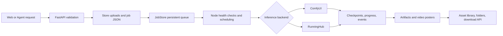

<div align="center">


# MiniMax H3 Studio

Unified control service for MiniMax H3 video, speech, Music3 and ComfyUI workflows

[](https://www.python.org/)
[](https://fastapi.tiangolo.com/)
[](https://github.com/Comfy-Org/ComfyUI)
[](https://huggingface.co/MiniMaxAI/MiniMax-H3)

[中文](README.md) | [English](README.en.md)

[Features](#features) · [Interface](#interface) · [Workflows](#workflows) · [Generation plans](#generation-plans) · [Local ComfyUI](#local-comfyui) · [Data flow](#data-flow) · [Update log](#update-log) · [Deployment](#deployment) · [Validation](#validation)

</div>

MiniMax H3 Studio provides one web interface, HTTP API, desktop entry and Android remote client for MiniMax H3, H3 TTS, digital human, Music3 and generic RunningHub workflows. The service handles request validation, reference uploads, a persistent queue, inference node scheduling, live events, task recovery, asset management and result delivery.


> [!IMPORTANT]
> This repository does not include model weights. Check the license terms of MiniMax H3, Music3, the LoRAs, ComfyUI and custom nodes before deploying.

## Features

| Area | Capability |
|---|---|
| Video generation | FL2VA, Ref2VA, 8-step LoRA, two-stage sampling, H3 SA, VDN H3, digital human and H3 NSFW |
| Audio generation | Music3 INT8 and H3 TTS with lyrics, style prompts and audio references |
| Long video | H3 SA splits at legal frame grids, carries context, trims duplicated frames and merges the result |
| VDN H3 | 8 to 50 steps with automatic DMD or B-stage selection |
| Job queue | Persistent queue, node scheduling, cancel, regenerate, checkpoint recovery and live progress |
| Total elapsed time | Measured from the moment an inference node starts the job; queue wait time is excluded |
| Asset library | Search, paging, status filters, cached video posters, preview, download and rename |
| Asset preview | Every asset opens in a preview dialog: images, a video player, audio as "file name + player", and unknown files with an unknown-file icon |
| Folders | Single-level folders, double-click to open, bulk move, an ungrouped root and deletion guards |
| Local assets | Capacity stats, 30-day video cleanup preview, ownership checks and artifact deletion |
| Detail windows | Several detail windows at once, independent drag and a collapsible sidebar |
| Node management | ComfyUI and RunningHub nodes, health checks, start/stop, concurrency and local/remote detection |
| Workflows | Import ComfyUI API workflows, map fields, references, ratio and MP, select result nodes, sync and validate |
| Run logs | Toolbar entry with a queue badge, a draggable dialog, live progress, and workflow sync/generation errors |
| Local ComfyUI | Experimental: launch and supervise a local ComfyUI from the app, with launch paths, private environments and process shutdown on exit |
| Multi-device | LAN or Tailscale pairing, authorization revocation, proxied jobs and read-only remote assets |
| Android client | Phone and tablet remote client pinned to FL2VA FP8 + 8-step LoRA, supporting remote ComfyUI, RunningHub, multi-device, progress and downloads; Beta, not yet tested on devices |
| Agent access | A public `AGENT.md`, OpenAPI JSON and Skill authoring rules |


> [!WARNING]
> The Android APK is Beta. It has only been built and statically checked; installation, connection, file picking and downloads have not been verified on a real phone or tablet.

## Interface

| Workbench | Night workbench |
|---|---|
|  |  |

| Workflow manager | Inference nodes |
|---|---|
|  |  |


## Appearance

Day, night and follow-system appearance modes are available under Settings → Appearance. Follow-system is the default.

## Workflows

Built-in and imported workflows are stored in `data/config.db`. On first database creation, bundled JSON files under `workflows/` seed the built-in presets; runtime execution reads the database.

Every bundled workflow and every custom workflow synced to ComfyUI uses the `H3Studio_` prefix so users can identify Studio-owned files in ComfyUI's user workflow directory.

### Built-in workflows

| File | Purpose |
|---|---|
| `H3Studio_minimax_h3_fl2va_fp8_720p_15s_api.json` | FL2VA native sampling |
| `H3Studio_minimax_h3_fl2va_fp8_turbo_lora_api.json` | FL2VA 8-step LoRA |
| `H3Studio_minimax_h3_fl2va_fp8_sa_api.json` | FL2VA H3 SA |
| `H3Studio_minimax_h3_fl2va_vdn_api.json` | FL2VA VDN-H3 |
| `H3Studio_minimax_h3_ref2va_fp8_scaled_api.json` | Ref2VA native sampling |
| `H3Studio_minimax_h3_ref2va_fp8_turbo_lora_api.json` | Ref2VA 8-step LoRA |
| `H3Studio_minimax_h3_fl2va_fp8_turbo_lora_4step_api.json` | FL2VA 4-step LoRA |
| `H3Studio_minimax_h3_ref2va_fp8_turbo_lora_4step_api.json` | Ref2VA 4-step LoRA |
| `H3Studio_minimax_h3_ref2va_fp8_sa_api.json` | Ref2VA H3 SA |
| `H3Studio_minimax_h3_ref2va_vdn_api.json` | Ref2VA VDN-H3 |
| `H3Studio_minimax_h3_ref2va_fp8_dual_sampling_upscale_api.json` | Dual sampling |
| `H3Studio_minimax_h3_ref2va_fp8_digital_human_api.json` | Digital human |
| `H3Studio_minimax_h3_ref2va_fp8_tts_api.json` | H3 TTS |
| `H3Studio_minimax_h3_ref2va_fp8_nsfw_lora_api.json` | H3 NSFW (private mode only) |
| `H3Studio_minimax_music3_int8_api.json` | Music3 INT8 |
| `H3Studio_comfy_upscale_image_api.json` | Image upscale |
| `H3Studio_comfy_upscale_video_api.json` | Video upscale |

Built-in presets only allow changing whether they appear in the composer; they cannot be edited or deleted.

### Custom workflows

The web workflow dialog imports ComfyUI API-format JSON and configures:

- Generic field mappings: `prompt`, `lyrics`, `width`, `height`, `ratio`, `megapixels`, `duration`, `num_frames`, `steps`, `seed`
- Reference mappings by image, video or audio type and index
- Reference slots: `ref_images` / `ref_videos` / `ref_audios` create loader nodes for every uploaded file
- Static inputs, result node, result media type, target ComfyUI nodes and composer visibility

Jobs run from a snapshot of the graph, mappings, version and target nodes captured at submission. Scheduling only picks synced online nodes. Official reference limits are 9 images, 3 videos and 3 audio clips. After saving, the service syncs the workflow into each target ComfyUI user workflow directory as `H3Studio_{workflow_id}.json` and verifies its hash. Import, validation and sync errors appear in the run log.

## Local ComfyUI

"Bind a local ComfyUI service" under Settings → Experimental is off by default. Once enabled:

- ComfyUI nodes detected as local (`localhost`, `127.0.0.1`, local NIC addresses) show a yellow "Manageable" badge in the node list; once the supervised service is running the badge turns green and reads "Managed".
- The node editor accepts a ComfyUI launch path (a directory or `main.py`), written the Windows or macOS way: `~` expands, forward and back slashes are interchangeable, and a `file://` prefix is accepted.
- The switch in the top-right corner of a node card starts or stops the supervised process. A private environment inside the launch directory (`venv`, `.venv`, `env`, with `Scripts/python` on Windows and `bin/python` on macOS) is preferred; otherwise the global Python is used.
- The child process runs with `--listen 127.0.0.1 --port <node port>`, logs to `data/local-comfy/<node>.log` and mirrors into the run log; failures show the original error on the card.
- Quitting the app terminates the processes it started (with a Windows Job object as a backstop). ComfyUI started elsewhere is left alone and cannot be stopped from the app; the UI asks you to close it manually.
- Settings includes a "ComfyUI launch command" field, defaulting to `{python} {script} --listen {host} --port {port}`. It supports `{python}`, `{script}`, `{workdir}`, `{host}` and `{port}` placeholders and accepts extra arguments.

## Data flow



Job and configuration data live under `data/`:

| Path | Data |
|---|---|
| `data/config.db` | Nodes, folders, workflows, desktop settings and paired devices |
| `data/jobs/` | Job JSON, job logs and checkpoints |
| `data/uploads/` | Job reference files |
| `data/outputs/` | API-managed artifacts, sidecars and video posters |
| `data/local-comfy/` | Logs of supervised local ComfyUI processes |

Once a job reaches a terminal state, `elapsed_seconds` is derived from `started_at`; older jobs without `started_at` fall back to the creation time.

## Update log

### 2026-10-23

- Custom workflows support variable references, `ratio` / `megapixels` mappings, result/target node configuration and ComfyUI sync.
- Built-in workflows are seeded into the database on first start; runtime execution no longer depends on workflow environment variables.
- Bundled workflows and synced custom workflows use the `H3Studio_` filename prefix.
- Upgraded the 8-step FL2VA / Ref2VA LoRAs to lightx2v Minimax-h3-Turbo v1.1 768p, added 4-step workflows (FL2VA v1.3 / Ref2VA v1.0), and updated the SA workflows to reference the new LoRAs.
- Dialogs and detail windows now animate in and out; top-right toasts use an icon + message layout with an exit animation.
- The asset library now defaults to a width that shows exactly 3 columns; the redundant New generation button was removed.
- The 4-step and 8-step LoRAs keep their default step counts, but sampling steps are editable.
- Reference and asset files open in a unified preview dialog.
- Local ComfyUI supervision: launch path, editable launch command, private environment, managed process and live logs.

### 2026-10-22

- Rebuilt the interface around Apple-style design with day, night and follow-system appearance.
- Moved the run log into the top action bar with a queue badge and draggable dialog.
- Added banner cards, dedicated add/edit dialogs, RunningHub endpoints and auto-scheduling exclusions for inference nodes.
- Split Music3 prompt and lyrics side by side; added a standalone video upscale entry.
- Added bilingual frontend and backend error messages.

### 2026-10-21: Custom workflow management and reference compression

- Built-in presets and custom workflows moved into `data/config.db` with create, update, delete, read and sync endpoints.
- The web workflow panel uploads ComfyUI API JSON, configures generic fields and reference mappings, selects result nodes, saves static inputs and picks the target node and generation-area visibility.
- Custom workflows run from per-job snapshots; scheduling only uses nodes that are synced and online.
- A new `auto_compress_large_images` setting compresses reference images above 1 MB in the browser before upload.
- The settings window was split into model, system and upload tabs; custom workflows recognise video, audio and image artifacts.

### 2026-10-02: Database workflow configuration (Beta)

- Workflow configurations, imports and node sync endpoints can now be stored in the database.
- Custom workflows and the H3 NSFW presets in private mode are only visible with a valid authorization code.

### 2026-09-27: Android remote client Beta

- A remote-only Android APK with phone and tablet layouts; no Python, ComfyUI, nodes or models are installed on the device.
- First-launch server detection, optional `H3_API_KEY`, WebView cookie auth, file picking, result downloads and back-button handling.
- An `android/` Gradle project and a debug APK, marked Beta.

### 2026-09-23: Video upscaling and auto-upscale

- Real, anime and 3D upscaling at 2x and 4x for images and videos, plus post-generation auto-upscale.
- Long videos split by free VRAM, input resolution and scale, with slice progress, checkpoint recovery, merging and temp cleanup.
- The ComfyUI and API single-file upload limit became 2048 MB.

### 2026-09-17: Asset library, Agent docs and UI interactions

- A single-level `asset_folders` model, legacy job migration and `folder_id` ownership; the root only shows ungrouped local jobs and remote assets stay read-only.
- Create, rename, delete, bulk move and drag-to-folder; deleting a folder is blocked while jobs run and then clears records, references, artifacts, sidecars, posters and logs.
- Local asset capacity stats, a 30-day video cleanup preview, total size display and deletion protection for non-local assets.
- Video posters are cached on disk, and finished artifacts can be renamed.
- A public, non-cached `/AGENT.md` route; total elapsed time is now measured from the start of execution.
- Detail windows became blurred-free floating windows with multiple instances, independent dragging, pinning and a collapsed sidebar.

### 2026-09-16: H3 SA, VDN H3 and deployment packages

- H3 SA two-stage sampling, the Latent 3D Upscaler, Sol-Attn and Context Loop.
- VDN H3 with 8-step DMD and automatic 9-50 step B-stage selection.
- Checkpoints, reconnect recovery, job resubmission and node migration.
- VDN H3 node packs, workflows, model lists and cloud GPU install scripts.

### 2026-08-19 to 2026-08-20: Desktop app and multi-device

- macOS and Windows desktop entries plus GitHub Actions builds for both platforms.
- Device pairing, persistent authorization, revocation, proxied remote jobs and a shared asset library.
- An `AGENT.md` install guide and the pinned node pack list.

### 2026-08-17: RunningHub dynamic workflows

- RunningHub workflow and AI App URL resolution.
- Dynamic text, number, enum, boolean and media fields generated from the remote schema.
- Workflow schemas, account balance, current jobs and per-call cost are persisted.

### 2026-08-14: Music3 and multi-node scheduling

- The Music3 INT8 workflow with style and lyric assist endpoints.
- Multi-node ComfyUI configuration, health checks, capacity and scheduling.
- A forced-duration patch for Music3, FLAC output and balance persistence.

### 2026-08-07 to 2026-08-13: Core service and video plans

- The FastAPI service, ComfyUI engine adapter, job queue and web workbench.
- FL2VA, Ref2VA, the 8-step LoRA and digital human workflows.
- Driving-audio duration probing, artifact delivery and the first API docs.

The update log is newest first with one entry per day; the current state is 2026-10-23. The Android APK remains Beta and has not been verified on devices.

## Generation plans

- **Built-in ComfyUI workflows**: FL2VA, Ref2VA, H3 SA, VDN-H3, digital human, H3 TTS, Music3, and image/video upscaling presets that work out of the box.
- **Custom ComfyUI workflows**: import any ComfyUI API-format JSON, map fields, references, ratio/MP and target nodes.
- **RunningHub endpoints**: point a node at a RunningHub workflow or AI App and run through RunningHub with dynamic parameters and account/task information.

## Quick start

### API service

```bash
python3.11 -m venv .venv
. .venv/bin/activate
pip install -r requirements-api.txt

export H3_ROOT="$PWD"
export H3_COMFY_URL="http://127.0.0.1:8188"
export H3_PORT=8193
./run.sh
```

Without ComfyUI, use the fake engine:

```bash
H3_FAKE_ENGINE=1 H3_ENGINE=fake ./run.sh
```

### Desktop app

```bash
python3 -m venv .venv-desktop
. .venv-desktop/bin/activate
pip install -r requirements-desktop.txt
python scripts/run_desktop.py
```

Point it at a remote ComfyUI:

```bash
H3_DEFAULT_COMFY_URL=http://192.168.1.20:8188 \
H3_DEFAULT_COMFY_NAME="Remote ComfyUI" \
python scripts/run_desktop.py
```

Package the desktop app with `python scripts/build_desktop.py` (PyInstaller; `dist/MiniMaxH3Studio` on Windows, an `.app` / `.dmg` on macOS). Pushing to `main`, `beta` or a `v*` tag builds on Windows and macOS via [GitHub Actions](.github/workflows/build-desktop.yml) and uploads the artifacts.

### Android APK

`android/` is a remote-only client: no Python, ComfyUI, nodes or models are installed on the phone or tablet. After installing the APK, enter the URL of a running MiniMax Studio service; the app checks `/health` first and then connects. ComfyUI and RunningHub nodes stay configured on the server, and multi-device pairing is managed there too. The generation screen is pinned to MiniMax H3 FL2VA FP8 with the 8-step LoRA.

Use `http://SERVER_IP:8193` on a LAN and HTTPS for internet access. The root URL must serve the Studio UI and `/health` directly. If the server sets `H3_API_KEY`, enter the same key on the connection screen; otherwise leave it empty.

Building requires JDK 17 and Android SDK Platform 34:

```bash
cd android
bash gradlew assembleDebug
```

On Windows use `gradlew.bat assembleDebug`. The installable APK lands at `android/app/build/outputs/apk/debug/app-debug.apk`. The debug build can be sideloaded; public releases should be signed with your own key.

### API documentation

After the service starts, open `/docs` for the FastAPI-generated Swagger UI and `/openapi.json` for the OpenAPI description. The API reference is no longer maintained in this README.

## Asset management

- **Preview and download**: clicking a reference asset, a message asset or a detail source file opens a preview dialog. Images, videos, audio and unknown files each have a suitable view; downloads only happen from an explicit download button.
- **Folders**: single-level folders with create, rename, delete, double-click open, bulk move and an ungrouped root. Deletion checks active tasks; remote assets are read-only.
- **Local assets**: capacity and file counts, 30-day video cleanup preview, artifact deletion and ownership checks.

## Node packs and installation assets

Pinned node packs, patches and SHA-256 manifests live in [`comfyui_nodes/`](comfyui_nodes/). The installer deploys ComfyUI, node packs, workflows and models.

Linux and Windows PCs share the same installer logic and resource bundle. Linux uses a Python installer with a resource ZIP; Windows uses a PowerShell script with the same ZIP and a double-clickable BAT entry. Run it and enter the target ComfyUI directory; the installer reuses a valid install or creates ComfyUI in an empty directory, then imports resources and downloads models that fit the GPU. Node packs, workflows, patches and the Windows Python core ship inside the ZIP, so no installer or project files are fetched from GitHub. Model weights, PyTorch and Python dependencies still download from the network, and the installer benchmarks ModelScope, Hugging Face and HF-Mirror before choosing a source. See the [Agent ComfyUI install guide](AGENT_HOW_TO_INSTALL.md).

On Linux with Python 3.11:

```bash
python3.11 scripts/install_minimax_comfyui.py
```

On Windows install Python 3.11, put `scripts/install_minimax_comfyui.ps1` and `scripts/MiniMaxH3-ComfyUI-Resources.zip` in one directory, and double-click `scripts/install_minimax_comfyui.bat` or run `powershell.exe -NoProfile -ExecutionPolicy Bypass -File scripts/install_minimax_comfyui.ps1`. PowerShell extracts the installer core to a temp directory, so no separate `.py` file is needed. The automatic profile uses H3 FL2VA 8-step on 24 GB NVIDIA GPUs, Music3 INT8 on 16-23 GB, and installs only compatible nodes and workflows below that or without an NVIDIA GPU. Agents can pass `--comfy-root`, `--model-profile` and `--model-provider` for unattended installs.

## Deployment

Installer:

```bash
INSTALL_ROOT=/data/minimax-h3-stack \
PYTHON_BIN=python3.11 \
GPU_ID=0 \
MODEL_PROVIDER=modelscope \
bash scripts/install.sh
```

Common environment variables:

| Variable | Purpose |
|---|---|
| `INSTALL_ROOT` | Root directory for ComfyUI, the API and models |
| `PYTHON_BIN` | Python used by the API and ComfyUI |
| `GPU_ID` | GPU index used by ComfyUI |
| `MODEL_PROVIDER` | `modelscope` or `huggingface` |
| `COMFY_PORT` | ComfyUI port, default 8188 |
| `API_PORT` | API port, default 8193 |
| `SKIP_MODELS` | Skip downloads when models already verify |
| `START_SERVICES` | Start services after installing |
| `DRY_RUN` | Print the plan only |

See [cloud GPU deployment](docs/DEPLOYMENT.md) and [operations](docs/OPERATIONS.md) for recovery and backup rules.

## Validation

```bash
python3 -m unittest discover -s tests -p 'test_*.py'
node --check static/app.js
python3 -m py_compile app/main.py app/jobs.py
git diff --check
```

Deployment validation:

```bash
INSTALL_ROOT=/data/minimax-h3-stack bash scripts/verify_install.sh
```

## Project layout

```text
app/                  FastAPI, job queue, workflow config, node scheduling, local ComfyUI supervision and inference clients
static/               Bilingual responsive web UI
workflows/            Built-in API workflows with the H3Studio_ prefix
comfyui_nodes/        Pinned node sources and manifest
scripts/              Install, download, verify, desktop packaging and generation tests
android/              Remote-only Android client (Beta)
deploy/               systemd service templates
patches/              ComfyUI compatibility patches
docs/                 API, deployment, models, workflows and operations docs
data/                 SQLite config, job state, uploads and artifacts
tests/                API contract, workflow and desktop tests
AGENT.md              Agent call order and Skill authoring guide
AGENT_HOW_TO_INSTALL.md  ComfyUI and node pack install guide
```

## Documentation

- [API reference](docs/en/API.md)
- [Cloud GPU deployment](docs/en/DEPLOYMENT.md)
- [Operations](docs/en/OPERATIONS.md)
- [Model list](docs/MODELS.md)
- [Workflow list](docs/WORKFLOWS.md)
- API: open `/docs` after the service starts
- [Desktop app](docs/DESKTOP.md)
- [ComfyUI node packs](comfyui_nodes/README.md)
- [AI Agent guide](AGENT.md)
- [Security](SECURITY.md)
- [Third-party notices](THIRD_PARTY_NOTICES.md)
