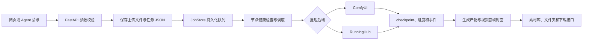

<div align="center">


# MiniMax H3 Studio

MiniMax H3 视频、语音、Music3 与 ComfyUI 工作流控制服务

[](https://www.python.org/)
[](https://fastapi.tiangolo.com/)
[](https://github.com/Comfy-Org/ComfyUI)
[](https://huggingface.co/MiniMaxAI/MiniMax-H3)

[中文](README.md) | [English](README.en.md)

[功能](#功能) · [数据流程](#数据流程) · [更新日志](#更新日志) · [部署](#部署) · [API](#api) · [验证](#验证)

</div>

MiniMax H3 Studio 为 MiniMax H3、H3 TTS、数字人、Music3 和通用 RunningHub 工作流提供统一的网页界面、HTTP API、桌面入口与 Android 远程客户端。服务负责请求校验、参考文件上传、持久化队列、推理节点调度、实时事件、任务恢复、素材管理和产物交付。


> [!IMPORTANT]
> 仓库不包含模型权重。部署前请确认 MiniMax H3、Music3、相关 LoRA、ComfyUI 和自定义节点的许可条件。

## 功能

| 模块 | 能力 |
|---|---|
| 视频生成 | FL2VA、Ref2VA、8 步 LoRA、双阶段采样、H3 SA、VDN H3、数字人和 H3 NSFW |
| 音频生成 | Music3 INT8 和 H3 TTS，支持歌词、曲风描述和音频参考 |
| 长视频 | H3 SA 按合法帧网格拆分、传递上下文、裁切重复帧并合并视频 |
| VDN H3 | 8 至 50 步，自动选择 DMD 或 B stage 路径 |
| 任务队列 | 持久化排队、节点调度、取消、重新生成、checkpoint 恢复和实时进度 |
| 总体耗时 | 从任务开始由推理节点处理起计算，排队等待时间不计入 |
| 素材库 | 搜索、分页、状态筛选、视频首帧封面缓存、预览、下载和重命名 |
| 文件夹 | 单层文件夹、双击进入、批量移动、未分组根目录和删除保护 |
| 本地素材管理 | 容量统计、30 天前视频预览清理、素材所有权校验和产物删除 |
| 详情窗口 | 无背景模糊、窗口阴影、多个窗口同时打开、独立拖拽和详情侧栏收起 |
| 节点管理 | ComfyUI 与 RunningHub 节点配置、健康检查、启停和并发设置 |
| 工作流管理 | 内置预设与自定义 ComfyUI 工作流、字段与素材映射、结果节点选择、节点同步和校验 |
| 皮肤系统 | 设置内切换界面皮肤，默认皮肤为当前视觉基线；皮肤仅改变视觉，不影响功能与数据 |
| 多端互联 | 局域网或 Tailscale 配对、授权撤销、本机代理任务和远端素材只读访问 |
| Android 客户端 | 手机和平板远程连接 Studio 服务，固定 FL2VA FP8 + 8 步 LoRA，支持远端 ComfyUI、RunningHub、多端互联、任务进度和结果下载；当前为 Beta，尚未完成实机测试 |
| Agent 接入 | Swagger UI、OpenAPI JSON、公开 `AGENT.md` 和 Skill 创建规范 |

前端还包括素材库宽度拖拽、宽度 `localStorage` 持久化、最大 50% 宽度、固定素材卡片尺寸、隐藏滚动条、调整宽度后的补页加载、日志产物定位和实时日志尾部跟随控制。

> [!WARNING]
> Android APK 当前处于 Beta 阶段，尚未经过真实 Android 手机或平板实机测试。目前仅完成 APK 构建和代码静态检查；安装、连接、文件选择、下载等设备行为尚未实机验证。

## 界面截图

| 工作台 | 极光玻璃皮肤 |
|---|---|
|  |  |

## 外观与皮肤

界面提供三种外观模式，在「设置 → 外观」中切换，立即生效：

| 模式 | 行为 |
|---|---|
| 日间 | 固定浅色外观 |
| 夜间 | 固定深色外观 |
| 跟随系统 | 读取 `prefers-color-scheme`，系统深浅色变化时实时切换（默认） |

模式保存在本机 `localStorage` 的 `h3-theme` 键；旧版本的 `h3-skin` 会自动迁移为日间或夜间。底层仍由两套皮肤样式实现：

| 模式 | 底层皮肤 | 风格 |
|---|---|---|
| 日间 | 原野（默认） | Apple 风格浅色：浅灰画布、单一 Action Blue、发丝分隔与胶囊控件 |
| 夜间 | 极光玻璃 Aurora Glass | 深色玻璃拟态：极光背景、青色与紫色渐变、衬线标题 |
| 跟随系统 | 自动选择 | 系统深色时用极光玻璃，否则用原野 |

| 外观设置 | 夜间工作台 |
|---|---|
|  |  |

外观是纯展示层：CSS 只覆盖设计令牌和装饰属性，不改变 DOM 结构、元素顺序、可见性、文案或任何 JavaScript 行为。生成、队列、素材、工作流和 API 在三种模式下完全一致。

### 文字层级

界面文字统一为 10 级，全部通过 `:root` 的 `--text-*` 令牌引用。新增模块不得写死 `font-size`，需要新字号时先扩展令牌。

| 令牌 | 字号 | 用途 |
|---|---:|---|
| `--text-micro` | 10px | 大写分组标签、徽标 |
| `--text-caption` | 11px | 元信息、辅助说明 |
| `--text-small` | 12px | 次级标签、控件文字 |
| `--text-ui` | 13px | 表单、按钮、列表 |
| `--text-body` | 14px | 基础正文 |
| `--text-lead` | 16px | 对话正文、强调 |
| `--text-heading-sm` | 20px | 分区标题 |
| `--text-heading` | 24px | 弹窗与侧栏标题 |
| `--text-display` | 28px | 页面标题 |
| `--text-hero` | 32px | 空状态主标题 |

### 新增外观与皮肤的规则

追加新模块、新外观模式或新皮肤时遵守以下约定，三种模式和既有皮肤都不会被破坏：

1. 组件颜色与字号只使用 `:root` 设计令牌（`--canvas`、`--surface`、`--ink`、`--line`、`--accent`、`--blue`、`--text-*` 等），不要写死色值或 `font-size`。
2. 皮肤样式写入 [`static/skins/skins.css`](static/skins/skins.css)，且必须限定在 `html[data-skin="<id>"]` 之下；不得为了某个皮肤修改基础规则。
3. 皮肤只能覆盖颜色、边框、阴影、圆角、字体和背景；不得改变布局结构、尺寸、元素顺序、可见性或交互逻辑。
4. 皮肤资源放在 `static/skins/<id>/`，预览图固定命名 `preview.jpg`（16:10）。
5. 新增外观模式需要同时更新 [`static/app.js`](static/app.js) 的 `THEMES`、`resolveThemeSkin()` 和设置外观面板的 `data-theme-option` 卡片；`data-skin` 仍只取 `default`（日间）或 `aurora`（夜间）。
6. 新模块若使用 Canvas、WebGL 或图表等无法被 CSS 换肤的绘制方式，监听 `h3:themechange` 事件读取 `event.detail.theme` / `event.detail.skin` 后重绘；`h3:skinchange` 仍会在解析后的皮肤变化时派发。
7. 合并前运行完整测试；默认模式必须保持为当前视觉基线，调整基础设计时同步更新文档截图和静态资源版本号，并至少手动检查一次三种模式的关键页面。

## 数据流程



任务目录和配置数据保存在 `data/`：

| 路径 | 数据 |
|---|---|
| `data/config.db` | 节点、文件夹、桌面设置和互联设备 |
| `data/jobs/` | 任务 JSON、任务日志和 checkpoint |
| `data/uploads/` | 任务参考文件 |
| `data/outputs/` | API 管理的生成产物、sidecar 和视频封面 |

任务进入终态后，`elapsed_seconds` 使用 `started_at` 到终态时间的差值。旧任务缺少 `started_at` 时使用创建时间兼容显示。

## 更新日志

### 2026-10-22：运行日志移入功能栏

- 移除可拖动的浮动日志入口，改为顶部右侧功能栏中的运行日志按钮，队列数量以角标显示。
- 点击按钮打开日志弹框；弹框不显示遮罩，可拖动标题栏调整位置，点击入口按钮、关闭按钮或按 Esc 关闭。
- 日志打开时入口按钮显示为选中态（蓝色图标 + 浅色底）。
- 「显示运行日志」设置继续控制该入口和弹框。

### 2026-10-22：API 错误双语

- 前端请求统一发送 `Accept-Language`，后端 `HTTPException` 根据该头返回对应语言的错误信息。
- 新增 `app/i18n.py` 错误文案目录：覆盖 149 条固定文案及文件大小、参考素材序号、远端连接等动态模板；未知或上游异常保留原文。
- 前端校验错误的分隔符、桌面端 403 提示也同步切换语言。

### 2026-10-22：双语覆盖补全

- 逐一检查中英文界面：补齐设置、推理节点、工作流编辑、素材详情、本地素材、超分、互联等弹窗遗漏的英文文案、占位符、按钮、确认提示、title 与 aria-label。
- 修复自定义下拉在切换到英文后仍显示旧中文选项的问题，语言切换后会同步刷新触发器文字。
- 英文模式下动态状态、数量单位、队列信息、节点/素材操作提示统一使用英文。

### 2026-10-22：节点本机/远程判定

- 推理节点的本机/远程改为按地址判断：`localhost`、`127.0.0.1` 和本机网卡 IP 属于本机，其余地址（包括 Tailscale/局域网/公网和 RunningHub）均归为远程。
- 远程地址的节点会在元信息中标注「远程节点」，汇总栏同步显示本机/远程数量。
- 隐藏节点管理错误提示时不再占用底部内边距。

### 2026-10-22：Music3 输入区左右分栏

- 工作流切换到 Music3 INT8 时，提示词与歌词改为左右并排，两个输入框保持原有高度，工具栏仍在下方。

### 2026-10-22：推理节点横幅与 RunningHub 开关

- 设置 → 系统新增「启用 RunningHub 端点工作流」，默认开启；关闭后无法新增或修改 RunningHub 节点，已有节点保留但标记为不可用。
- 新增「自动调度时排除 RunningHub 节点」，默认关闭；开启后自动调度不会再选择 RunningHub 节点，以自动调度提交 RunningHub 工作流会被直接拒绝。
- 推理节点弹框改为固定尺寸（940 × 700），每个节点以横幅卡片呈现状态、地址、并发与操作。
- 新增/编辑节点改为独立弹窗，表单与节点列表分离。

### 2026-10-22：独立视频超分入口

- 视频超分操作补充图标，并改为先弹出类型与倍率选择。
- 确认后直接提交独立的视频超分任务，不再切换或重置当前工作流、输入区和参考素材。
- 类型支持真人、动画、3D；倍率支持 2x、4x；任务沿用原视频所在文件夹。

### 2026-10-22：日间 / 夜间 / 跟随系统

- 外观切换从皮肤列表改为三种模式：日间、夜间、跟随系统。
- 跟随系统监听 `prefers-color-scheme`，系统外观变化时实时切换。
- 模式保存在 `h3-theme`；旧 `h3-skin` 自动迁移为日间或夜间。
- 底层继续使用原野与极光玻璃两套皮肤样式。

### 2026-10-22：Apple 风格界面重做

- 参考 apple.com 的布局与层级：浅灰画布 `#f5f5f7` 搭配白色内容区、发丝分隔线和单一 Action Blue `#0071e3`，移除装饰性渐变与卡片投影。
- 字体层级：页面标题 28px、侧栏标题 24px、弹窗标题 24px、对话正文 16px；标题使用 SF Pro Display 负字距，全部文字收敛为 10 至 32px 的十级 `--text-*` 令牌。
- 布局：侧栏加宽到 320px，顶栏 88px，节点与工作流入口移到右侧操作区；输入区改为 28px 圆角浅灰面板，控件高度 44px。
- 组件：胶囊按钮、分段式设置页签、18px 卡片圆角、圆形图标按钮，以及按下缩放 0.97 的反馈。
- 新增空状态大标题与说明；极光玻璃皮肤同步适配新的字号、侧栏宽度和分段控件。

### 2026-10-22：皮肤系统与极光玻璃

- 新增可切换皮肤机制，默认皮肤保持当时的视觉，皮肤只改变视觉、不影响功能。
- 新增「极光玻璃」深色皮肤：极光背景、玻璃拟态面板、衬线标题和青色/紫色渐变强调。
- 设置新增「外观」页签，切换后立即生效，并保存在本机 `localStorage` 的 `h3-skin` 键。
- 皮肤样式集中在 `static/skins/skins.css`，全部限定在 `html[data-skin="<id>"]` 下，不修改基础规则；全局视觉层位于 `static/design.css`。
- 新增 `h3:skinchange` 事件，供 Canvas、图表等非 CSS 模块在换肤时重绘。
- 约定新模块只使用设计令牌（`--canvas`、`--surface`、`--ink` 等），保证后续模块自动兼容所有皮肤。

### 2026-10-21：自定义工作流管理与参考图压缩

- 内置预设与自定义工作流统一写入 `data/config.db`，新增 `GET/POST /api/v1/workflows`、`GET/PATCH/DELETE /api/v1/workflows/{workflow_id}` 和 `POST /api/v1/workflows/{workflow_id}/sync`。
- 网页端新增工作流管理面板：上传 ComfyUI API 格式 JSON，配置通用字段与参考素材映射，选择结果节点，保存静态输入，指定目标节点和生成区显示。
- 自定义工作流按任务快照执行。提交 `workflow_id` 后使用创建时保存的工作流图、映射、版本和目标节点；调度只选择已同步且在线的目标节点。
- 新增 `auto_compress_large_images` 设置，参考图片超过 1 MB 时在浏览器本地压缩后再上传，并显示处理状态。
- 设置窗口拆分为模型、系统、上传三个页签；内置预设支持中英双语简介，自定义工作流可选填写简介。
- 自定义工作流支持视频、音频和图片产物识别，历史记录只读取配置的结果节点。

### 2026-10-02：数据库工作流配置（Beta）

- 增加通过数据库保存 ComfyUI 工作流配置、工作流导入和节点同步接口。
- 私密模式中的自定义工作流与 H3 NSFW 预设仅对有效授权码可见。

### 2026-09-27：Android 远程客户端 Beta

- 增加纯远程 Android APK，支持手机和平板布局；客户端不在设备上安装 Python、ComfyUI、节点或模型。
- 增加首次启动服务器地址检测、可选 `H3_API_KEY`、WebView Cookie 认证、文件选择、结果下载和返回键处理。
- Android 模式固定使用 `fl2va-fp8`、`turbo-lora` 和 8 步采样，保留远端 ComfyUI、RunningHub、多端互联、队列、素材库和 SSE 进度。
- 增加 `android/` Gradle 工程和 debug APK 产物。当前 APK 尚未经过 Android 手机或平板实机测试，暂定为 Beta 版本。

### 2026-09-23：视频超分与自动超分

- 增加真人、动画、3D 三类图片和视频 2x、4x 超分。
- 增加生成后自动超分选项，普通视频生成任务完成后在同一任务内继续执行超分，并直接返回超分视频。
- 增加长视频按 GPU 空闲显存、输入分辨率和倍率自动切片，支持切片进度、checkpoint 恢复、合并和中间文件清理。
- 将 ComfyUI 和 API 单文件上传上限调整为 2048 MB。
- 核对远程 ComfyUI 中新增的 LTX 2x 模型，确认其需要潜空间超分工作流，当前像素超分流继续使用已验证的图像超分模型。

### 2026-09-17：素材库、Agent 文档与界面交互

- 增加 `asset_folders` 单层文件夹、旧任务迁移和 `folder_id` 归属。
- 根目录只显示未分类本机任务，远端素材保持只读。
- 增加新建、重命名、删除、批量移动和文件夹拖拽归类。
- 删除文件夹前阻止进行中任务，确认后清理任务记录、参考文件、产物、sidecar、封面和日志。
- 增加本地素材容量统计、30 天前视频清理预览、总大小展示和非本机素材删除保护。
- 生成文件使用目录名称前缀和时间戳，已完成产物支持用户重命名。
- 视频首帧封面落盘缓存，重复刷新时直接使用缓存。
- 增加 `/AGENT.md` 公共路由，返回 Markdown 并禁用缓存；同步 OpenAPI、鉴权、任务、素材和 Skill 创建说明。
- 将总体耗时改为从任务开始执行起计算，排队时间不计入。
- 素材库增加固定卡片布局、宽度持久化、隐藏滚动条、调整宽度后的补页加载和目录式文件夹卡片。
- 详情窗口改为无模糊浮动窗口，支持多开、独立拖拽、窗口置顶和默认收起的详情侧栏。

### 2026-09-16：H3 SA、VDN H3 与部署包完善

- 增加 H3 SA 两阶段采样、Latent 3D Upscaler、Sol-Attn 和 Context Loop。
- 增加 VDN H3 的 8 步 DMD 与 9 至 50 步 B stage 自动选择。
- 增加 checkpoint、断线恢复、任务重新提交和节点迁移。
- 补充 VDN H3 节点包、工作流、模型清单和云 GPU 安装脚本。

### 2026-08-19 至 2026-08-20：桌面应用与多端互联

- 增加 macOS 和 Windows 桌面应用入口。
- 增加设备配对、持久授权、授权撤销、远端任务代理和共享素材库。
- 增加运行日志浮窗、日志启动器拖拽和触控拖拽。
- 增加 `AGENT.md` 安装指南和固定版本节点包清单。

### 2026-08-17：RunningHub 动态工作流

- 支持 RunningHub 工作流和 AI App 资源地址解析。
- 根据远端 schema 动态生成文本、数值、枚举、开关和媒体字段。
- 保存工作流 schema、账户余额、当前任务和单次调用费用。
- 在远端参数或账户查询失败时保留最近一次可用运行信息。

### 2026-08-14：Music3 与多节点调度

- 增加 Music3 INT8 工作流、曲风和歌词辅助接口。
- 增加多 ComfyUI 节点配置、健康检查、容量和任务调度。
- 增加 Music3 强制时长补丁、FLAC 输出和余额状态保存。
- 增加消融测试脚本、模型清单和安装校验流程。

### 2026-08-07 至 2026-08-13：基础服务与视频方案

- 建立 FastAPI 服务、ComfyUI 引擎适配、任务队列和网页工作台。
- 增加 FL2VA、Ref2VA、8 步 LoRA 和数字人工作流。
- 增加驱动音频时长读取、视频产物回传和基础 API 文档。
- 加入项目 Logo、工作台截图和英文文档。

以上更新日志按时间倒序排列，当前工作区状态截至 2026-10-22。更新记录同时包含代码、工作流、文档、测试和云端发布过程；Android APK 仍处于 Beta，尚未完成实机验证。

### 更新数据的发布流程

每次更新遵循以下流程：

1. 扫描后端、前端、工作流、测试和文档，确认数据结构与接口影响范围。
2. 修改代码和静态资源，涉及 SQLite 时保留迁移和旧数据兼容逻辑。
3. 增加后端接口契约、前端静态契约和行为回归测试。
4. 执行 Python 语法检查、JavaScript 语法检查、完整 unittest 和差异检查。
5. 更新静态资源版本参数，避免浏览器缓存旧的 HTML、CSS 和 JavaScript。
6. 发布前检查云 GPU 的任务队列、GPU 状态、磁盘空间和 ComfyUI 健康状态。
7. 在 `/home/tapcash/ssd2/backups/` 创建远端备份，排除 `data/`、模型、虚拟环境和用户产物。
8. 分目录同步源码、静态资源、工作流、测试和文档，校验本地与远端 SHA-256。
9. 有执行中任务时只同步可热加载的静态资源；API 重启前确认 checkpoint 可恢复，避免中断生成。
10. 重启 API 后验证 `/health`、`/AGENT.md`、`/docs`、`/openapi.json`、任务恢复、ComfyUI 和完整远端测试。

## 生成方案

| 方案 | 参考输入 | 时长 | 步数 | 产物 |
|---|---|---:|---:|---|
| FL2VA | 首帧图片，可选尾帧图片 | 1 至 15 秒 | 4 至 50 | MP4 |
| Ref2VA | 最多 9 张图片、3 段视频、3 段音频 | 1 至 15 秒 | 4 至 50 | MP4 |
| H3 SA | FL2VA 或 Ref2VA 参考素材 | 1 至 300 秒 | 固定 8 | MP4 |
| VDN H3 | FL2VA 或 Ref2VA 参考素材 | 1 至 15 秒 | 8 至 50 | MP4 |
| 数字人 | 人物图片和驱动音频 | 由音频决定 | 固定 20 | MP4 |
| H3 TTS | 人物特征、对白和音频参考 | 1 至 15 秒 | 4 至 50 | FLAC |
| Music3 | 曲风描述和可选歌词 | 1 至 300 秒 | 固定 30 | FLAC |
| RunningHub | 目标工作流定义的字段 | 由工作流定义 | 由工作流定义 | 由工作流定义 |

## 快速开始

### API 服务

```bash
python3.11 -m venv .venv
. .venv/bin/activate
pip install -r requirements-api.txt

export H3_ROOT="$PWD"
export H3_COMFY_URL="http://127.0.0.1:8188"
export H3_PORT=8193
./run.sh
```

没有 ComfyUI 时可以使用测试引擎：

```bash
H3_FAKE_ENGINE=1 H3_ENGINE=fake ./run.sh
```

### 桌面应用

```bash
python3 -m venv .venv-desktop
. .venv-desktop/bin/activate
pip install -r requirements-desktop.txt
python scripts/run_desktop.py
```

指定远端 ComfyUI：

```bash
H3_DEFAULT_COMFY_URL=http://192.168.1.20:8188 \
H3_DEFAULT_COMFY_NAME="远端 ComfyUI" \
python scripts/run_desktop.py
```

### Android APK

`android/` 是纯远程客户端，不在手机或平板上安装 Python、ComfyUI、节点或模型。安装 APK 后输入已运行的 MiniMax Studio 服务地址；应用会先检查 `/health`，再连接服务。ComfyUI 和 RunningHub 节点仍在 Studio 服务端配置，多端互联也由服务端管理。APK 生成界面固定使用 MiniMax H3 FL2VA FP8 和 8-step LoRA。

内网服务可填写 `http://服务器IP:8193`，外网服务建议使用 HTTPS。服务根地址需要能直接打开 Studio 网页与 `/health` 接口。若服务设置了 `H3_API_KEY`，在 APK 连接页一并填写；未设置时留空。

构建需要 JDK 17 和 Android SDK Platform 34：

```bash
cd android
bash gradlew assembleDebug
```

Windows 使用 `gradlew.bat assembleDebug`。可安装 APK 位于 `android/app/build/outputs/apk/debug/app-debug.apk`。该调试版 APK 可直接侧载；公开发布时应使用自己的签名密钥构建 release 版本。

### API 入口

| 地址 | 作用 |
|---|---|
| `/` | Web 工作台 |
| `/health` | 服务、节点和队列状态 |
| `/docs` | Swagger UI |
| `/openapi.json` | OpenAPI JSON |
| `/AGENT.md` | AI Agent 和 Skill 接入说明 |

设置 `H3_API_KEY` 后，普通 API 请求使用：

```http
Authorization: Bearer YOUR_H3_API_KEY
```

## API

创建视频任务：

```bash
curl -X POST http://127.0.0.1:8193/api/v1/generations \
  -F 'prompt=固定机位，人物持续向前行走，保持人物身份和环境连续。' \
  -F 'reference_manifest=[{"type":"image"}]' \
  -F 'references=@first-frame.png;type=image/png' \
  -F 'model_variant=fl2va-fp8' \
  -F 'execution_mode=turbo-lora' \
  -F 'width=864' \
  -F 'height=480' \
  -F 'duration=5' \
  -F 'steps=8' \
  -F 'comfy_node=auto'
```

任务查询和产物下载：

```bash
curl http://127.0.0.1:8193/api/v1/generations/JOB_ID
curl http://127.0.0.1:8193/api/v1/generations/JOB_ID/result -o output.mp4
```

常用接口：

| 方法 | 路径 | 作用 |
|---|---|---|
| `GET` | `/health` | 服务、节点和队列状态 |
| `GET` | `/api/v1/comfy/nodes` | 查询推理节点 |
| `GET` | `/api/v1/workflows` | 查询内置预设与自定义工作流 |
| `POST` | `/api/v1/workflows` | 创建工作流 |
| `PATCH` | `/api/v1/workflows/{workflow_id}` | 修改工作流或生成区显示 |
| `DELETE` | `/api/v1/workflows/{workflow_id}` | 删除自定义工作流 |
| `POST` | `/api/v1/workflows/{workflow_id}/sync` | 同步并校验目标节点工作流 |
| `POST` | `/api/v1/generations` | 创建任务 |
| `GET` | `/api/v1/generations/{job_id}` | 查询任务 |
| `POST` | `/api/v1/generations/{job_id}/cancel` | 取消任务 |
| `POST` | `/api/v1/generations/{job_id}/regenerate` | 重新生成 |
| `GET` | `/api/v1/generations/{job_id}/result` | 下载产物 |
| `GET` | `/api/v1/events` | SSE 事件流 |
| `POST` | `/api/v1/prompts/optimize` | H3 提示词优化 |
| `POST` | `/api/v1/music/assist` | Music3 曲风或歌词辅助 |

提交任务时可传入 `workflow_id` 选择内置预设或自定义工作流；省略时继续按 `model_variant` 与 `execution_mode` 选择内置方案。

完整字段、错误码、RunningHub 动态参数、多端互联和素材接口见 [API 参考](docs/API.md)。面向自动化 Agent 的调用顺序、工具封装和验收要求见 [`AGENT.md`](AGENT.md)。

## 素材管理

### 文件夹与归属

文件夹为单层结构，名称长度为 1 至 80 个字符，同级名称按大小写折叠后判重。新任务可以指定 `folder_id`，选择根目录或未分组时归入未分组。

```text
GET    /api/v1/asset-folders
POST   /api/v1/asset-folders
PATCH  /api/v1/asset-folders/{folder_id}
POST   /api/v1/asset-folders/move
DELETE /api/v1/asset-folders/{folder_id}
```

外层素材列表只显示未分类本机任务。双击文件夹进入后显示其中的视频素材。移动使用任务归属关系，不复制文件。远端素材保持只读，不接受移动、重命名和删除。

删除文件夹前会检查排队中和执行中的任务。检查通过后删除文件夹内已结束任务的记录、参考文件、生成产物、sidecar、封面和日志。

### 本地素材管理

```text
GET  /api/v1/assets/local
GET  /api/v1/assets/local/clear-old-video/preview
POST /api/v1/assets/local/clear-old-video
POST /api/v1/assets/local/delete
```

清理 30 天前视频前，客户端应展示所有项目、创建时间、单项大小和总大小，再执行确认。非本机创建的文件和文件夹不可删除。

## 工作流与节点包

API 格式工作流位于 [`workflows/`](workflows/)，固定版本节点包和 SHA-256 清单位于 [`comfyui_nodes/`](comfyui_nodes/)。主要工作流包括：

- `minimax_h3_fl2va_fp8_720p_15s_api.json`
- `minimax_h3_ref2va_fp8_scaled_api.json`
- `minimax_h3_fl2va_fp8_turbo_lora_api.json`
- `minimax_h3_ref2va_fp8_turbo_lora_api.json`
- `minimax_h3_fl2va_fp8_sa_api.json`
- `minimax_h3_ref2va_fp8_sa_api.json`
- `minimax_h3_fl2va_vdn_api.json`
- `minimax_h3_ref2va_vdn_api.json`
- `minimax_h3_ref2va_fp8_digital_human_api.json`
- `minimax_h3_ref2va_fp8_tts_api.json`
- `minimax_music3_int8_api.json`

服务提交前会注入提示词、参考文件、分辨率、帧数、步数、随机种子、文件夹名称前缀和输出路径。

网页端工作流管理入口支持上传 ComfyUI API 格式 JSON、配置通用字段和参考素材映射、选择单个结果节点、保存静态输入、选择目标 ComfyUI 节点以及控制生成区显示。内置工作流继续作为锁定预设存在，自定义工作流写入 `data/config.db`。保存后服务会尝试将副本同步到选定节点的 ComfyUI 用户目录，并按节点记录同步状态。

Linux 和 Windows PC 使用同一套安装逻辑及配套资源包。Linux 使用 Python 安装脚本和资源 ZIP；Windows 使用 PowerShell 脚本和资源 ZIP，BAT 文件提供双击入口。运行后输入目标 ComfyUI 目录，无需将安装文件迁移到目标目录。安装器会检查目标路径，复用有效的 ComfyUI 安装，或在空目录/新目录中安装 ComfyUI 本体，然后自动导入资源并下载匹配显存的模型。节点包、工作流、补丁和 Windows 所需的 Python 安装核心均在 ZIP 中，不会从 GitHub 下载安装脚本或项目资源。模型权重、PyTorch 和 Python 依赖仍需联网下载；安装器会测速 ModelScope、Hugging Face 和 HF-Mirror 后选择下载源。详见 [Agent ComfyUI 安装指南](AGENT_HOW_TO_INSTALL.md)。

Linux 使用 Python 3.11 运行：

```bash
python3.11 scripts/install_minimax_comfyui.py
```

Windows 安装 Python 3.11，将 `scripts/install_minimax_comfyui.ps1` 与 `scripts/MiniMaxH3-ComfyUI-Resources.zip` 放在同一目录；双击 `scripts/install_minimax_comfyui.bat` 可启动 PowerShell 入口，也可运行 `powershell.exe -NoProfile -ExecutionPolicy Bypass -File scripts/install_minimax_comfyui.ps1`。PowerShell 从 ZIP 提取安装核心到临时目录运行，Windows 不需要单独放置 `.py` 文件。自动方案在 24 GB 级 NVIDIA GPU 上使用 H3 FL2VA 8 步模型；16 至 23 GB 显存时选择 Music3 INT8；更低显存或未检测到 NVIDIA GPU 时只安装兼容节点和工作流。Agent 可使用 `--comfy-root`、`--model-profile` 和 `--model-provider` 参数进行无交互部署。

## 部署

安装脚本：

```bash
INSTALL_ROOT=/data/minimax-h3-stack \
PYTHON_BIN=python3.11 \
GPU_ID=0 \
MODEL_PROVIDER=modelscope \
bash scripts/install.sh
```

常用环境变量：

| 变量 | 作用 |
|---|---|
| `INSTALL_ROOT` | ComfyUI、API 和模型根目录 |
| `PYTHON_BIN` | API 和 ComfyUI 使用的 Python |
| `GPU_ID` | ComfyUI 使用的 GPU 编号 |
| `MODEL_PROVIDER` | `modelscope` 或 `huggingface` |
| `COMFY_PORT` | ComfyUI 端口，默认 8188 |
| `API_PORT` | API 端口，默认 8193 |
| `SKIP_MODELS` | 已有模型且校验通过时跳过下载 |
| `START_SERVICES` | 安装后启动服务 |
| `DRY_RUN` | 只打印安装计划 |

部署文档见 [云 GPU 部署](docs/DEPLOYMENT.md)。运行维护、任务恢复和备份规则见 [运行维护](docs/OPERATIONS.md)。

## 验证

```bash
python3 -m unittest discover -s tests -p 'test_*.py'
node --check static/app.js
python3 -m py_compile app/main.py app/jobs.py
git diff --check
```

部署目录验证：

```bash
INSTALL_ROOT=/data/minimax-h3-stack bash scripts/verify_install.sh
```

## 项目结构

```text
app/                  FastAPI、任务队列、工作流配置、节点调度和推理客户端
static/               中英文响应式网页
static/design.css     Apple 风格视觉层（画布、字号、表面、控件）
static/skins/         皮肤样式、预览图与背景资源
workflows/            H3、H3 SA、VDN H3 和 Music3 API 工作流
comfyui_nodes/        固定版本节点源码包和校验清单
scripts/              安装、下载、验证、桌面打包和生成测试
android/              纯远程 Android 客户端（Beta）
deploy/               systemd 服务模板
patches/              ComfyUI 兼容补丁
docs/                 API、部署、模型、工作流和运维文档
data/                 SQLite 配置、任务状态、上传素材和产物
tests/                API 契约、工作流和桌面功能测试
AGENT.md              AI Agent 接口调用和 Skill 创建指南
AGENT_HOW_TO_INSTALL.md  ComfyUI 与节点包安装指南
```

## 文档

- [API 参考](docs/API.md)
- [云 GPU 部署](docs/DEPLOYMENT.md)
- [运行维护](docs/OPERATIONS.md)
- [模型清单](docs/MODELS.md)
- [工作流清单](docs/WORKFLOWS.md)
- [桌面应用](docs/DESKTOP.md)
- [ComfyUI 节点包](comfyui_nodes/README.md)
- [AI Agent 指南](AGENT.md)
- [安全说明](SECURITY.md)
- [第三方项目与许可](THIRD_PARTY_NOTICES.md)
