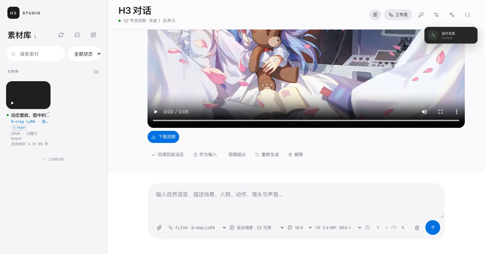
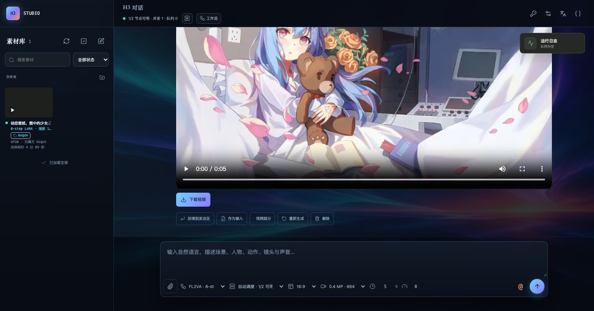
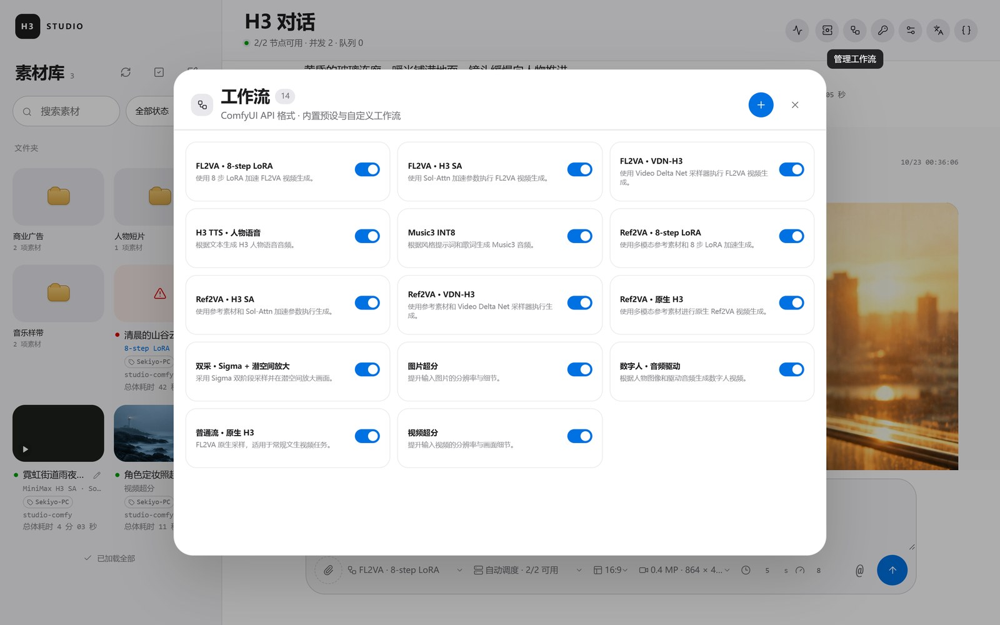
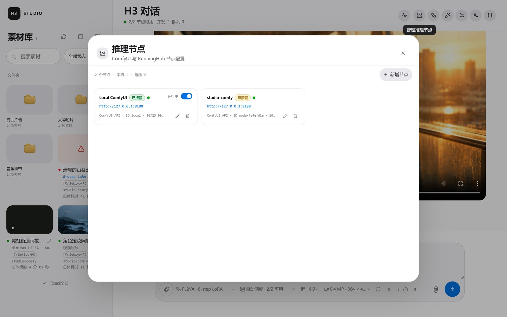
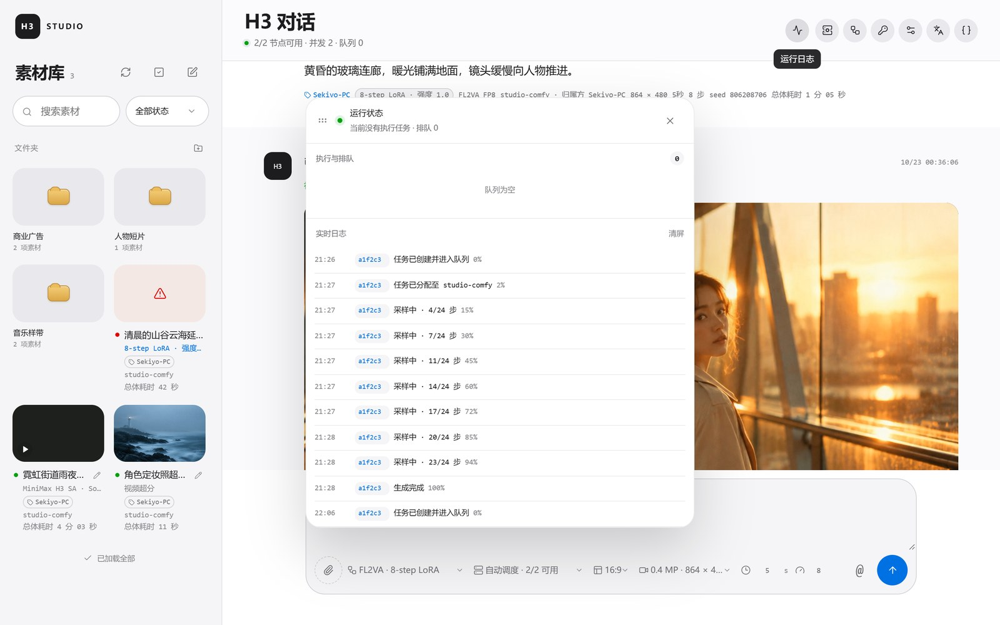

<div align="center">


# MiniMax H3 Studio

MiniMax H3 视频、语音、Music3 与 ComfyUI 工作流控制服务

[](https://www.python.org/)
[](https://fastapi.tiangolo.com/)
[](https://github.com/Comfy-Org/ComfyUI)
[](https://huggingface.co/MiniMaxAI/MiniMax-H3)

[中文](README.md) | [English](README.en.md)

[功能](#功能) · [界面](#界面) · [工作流](#工作流) · [生成方案](#生成方案) · [本地-comfyui](#本地-comfyui) · [数据流程](#数据流程) · [更新日志](#更新日志) · [部署](#部署) · [验证](#验证)

</div>

MiniMax H3 Studio 为 MiniMax H3、H3 TTS、数字人、Music3 和通用 RunningHub 工作流提供统一的网页界面、HTTP API、桌面入口与 Android 远程客户端。服务负责请求校验、参考文件上传、持久化队列、推理节点调度、实时事件、任务恢复、素材管理和产物交付。



> [!IMPORTANT]
> 仓库不包含模型权重。部署前请确认 MiniMax H3、Music3、相关 LoRA、ComfyUI 和自定义节点的许可条件。

## 功能

| 模块 | 能力 |
|---|---|
| 视频生成 | FL2VA、Ref2VA、8 步 LoRA、双阶段采样、H3 SA、VDN H3、数字人和 H3 NSFW |
| 音频生成 | Music3 INT8 和 H3 TTS，支持歌词、曲风描述和音频参考 |
| 长视频 | H3 SA 按合法帧网格拆分、传递上下文、裁切重复帧并合并视频 |
| VDN H3 | 8 至 50 步，自动选择 DMD 或 B stage 路径 |
| 任务队列 | 持久化排队、节点调度、取消、重新生成、checkpoint 恢复和实时进度 |
| 总体耗时 | 从任务开始由推理节点处理起计算，排队等待时间不计入 |
| 素材库 | 搜索、分页、状态筛选、首帧封面、弹窗预览、下载和重命名 |
| 文件夹 | 单层文件夹、批量移动、未分组根目录和删除保护 |
| 本地素材管理 | 容量统计、30 天前视频清理和产物删除 |
| 详情窗口 | 多窗口详情，支持拖拽与侧栏收起 |
| 节点管理 | ComfyUI 与 RunningHub 节点配置、健康检查和启停 |
| 工作流管理 | 导入 ComfyUI API 工作流，配置字段与参考素材并同步 |
| 运行日志 | 顶部入口、队列角标、可拖动日志框和实时错误 |
| 本地 ComfyUI | 实验性：从应用启动并托管本机 ComfyUI |
| 多端互联 | 局域网或 Tailscale 配对、授权撤销、本机代理任务和远端素材只读访问 |
| Android 客户端 | 手机和平板远程连接 Studio 服务，固定 FL2VA FP8 + 8 步 LoRA，支持远端 ComfyUI、RunningHub、多端互联、任务进度和结果下载；当前为 Beta，尚未完成实机测试 |
| 外观 | 日间、夜间和跟随系统三种外观，默认跟随系统 |
| Agent 接入 | 公开 `AGENT.md`、OpenAPI JSON 和 Skill 创建规范 |


> [!WARNING]
> Android APK 当前处于 Beta 阶段，尚未经过真实 Android 手机或平板实机测试。目前仅完成 APK 构建和代码静态检查；安装、连接、文件选择、下载等设备行为尚未实机验证。

## 界面

| 工作台 | 夜间工作台 |
|---|---|
|  |  |

| 工作流管理 | 推理节点 |
|---|---|
|  |  |



## 工作流

内置工作流和用户导入的工作流统一保存在 `data/config.db`。首次创建数据库时，`workflows/` 下的内置 JSON 会写入预设配置，运行时直接读取数据库；之后不会再用环境变量指定工作流文件。

所有本项目提供的工作流包，以及同步到 ComfyUI 的自定义工作流，文件名都以 `H3Studio_` 开头，方便在 ComfyUI 的用户工作流目录中识别。

### 内置工作流

| 文件 | 用途 |
|---|---|
| `H3Studio_minimax_h3_fl2va_fp8_720p_15s_api.json` | FL2VA 原生采样 |
| `H3Studio_minimax_h3_fl2va_fp8_turbo_lora_api.json` | FL2VA 8 步 LoRA |
| `H3Studio_minimax_h3_fl2va_fp8_sa_api.json` | FL2VA H3 SA |
| `H3Studio_minimax_h3_fl2va_vdn_api.json` | FL2VA VDN-H3 |
| `H3Studio_minimax_h3_ref2va_fp8_scaled_api.json` | Ref2VA 原生采样 |
| `H3Studio_minimax_h3_ref2va_fp8_turbo_lora_api.json` | Ref2VA 8 步 LoRA |
| `H3Studio_minimax_h3_ref2va_fp8_sa_api.json` | Ref2VA H3 SA |
| `H3Studio_minimax_h3_ref2va_vdn_api.json` | Ref2VA VDN-H3 |
| `H3Studio_minimax_h3_ref2va_fp8_dual_sampling_upscale_api.json` | 双阶段采样 |
| `H3Studio_minimax_h3_ref2va_fp8_digital_human_api.json` | 数字人 |
| `H3Studio_minimax_h3_ref2va_fp8_tts_api.json` | H3 TTS |
| `H3Studio_minimax_h3_ref2va_fp8_nsfw_lora_api.json` | H3 NSFW（仅私密模式） |
| `H3Studio_minimax_music3_int8_api.json` | Music3 INT8 |
| `H3Studio_comfy_upscale_image_api.json` | 图片超分 |
| `H3Studio_comfy_upscale_video_api.json` | 视频超分 |

内置预设只能调整是否在生成区显示，不能修改或删除。

### 自定义工作流

网页端「工作流」弹框可导入 ComfyUI API 格式 JSON，并配置字段映射、参考素材、结果节点、目标节点和生成区显示。提交任务后按创建时的快照执行，调度只选择已同步且在线的节点；参考素材上限为图片 9 张、视频 3 段、音频 3 段。保存后服务会同步到目标 ComfyUI 的用户工作流目录并校验，错误写入运行日志。

## 本地 ComfyUI

设置 →「实验性功能」中的「绑定本地 ComfyUI 服务」默认关闭。开启后，本机 ComfyUI 节点会显示可接管状态，可在节点卡片中启动或停止托管进程。应用优先使用节点目录中的私有环境，日志写入 `data/local-comfy/` 并同步到运行日志；退出时会结束自己启动的进程，外部启动的 ComfyUI 不受影响。启动命令支持常用占位符配置。

## 数据流程


任务目录和配置数据保存在 `data/`：

| 路径 | 数据 |
|---|---|
| `data/config.db` | 节点、文件夹、工作流、桌面设置和互联设备 |
| `data/jobs/` | 任务 JSON、任务日志和 checkpoint |
| `data/uploads/` | 任务参考文件 |
| `data/outputs/` | API 管理的生成产物、sidecar 和视频封面 |
| `data/local-comfy/` | 托管的本地 ComfyUI 进程日志 |

任务进入终态后，`elapsed_seconds` 使用 `started_at` 到终态时间的差值。旧任务缺少 `started_at` 时使用创建时间兼容显示。

## 更新日志

### 2026-10-23

- 对话消息支持默认、极简和宫格三种样式；提示词支持 Markdown，宫格使用纯封面、hover 信息蒙版、省略提示词、快捷删除和任务取消。
- 宫格历史逐张浮现；对话流与素材库改为原位 DOM 复用，加载和状态更新不再闪烁或跳滚动位置。
- 新增回到最新位置按钮：宫格回到顶部，对话回到底部；宫格「回填到发送区」和消息样式切换都定位到最新内容。
- 显示设置新增素材库开关（收起动画、宽屏宫格 6 列）和输入框样式（固定 / 浮动）；素材库与对话流滚动边界加入渐隐过渡。
- 左上角品牌改为应用 Logo。
- 自定义工作流支持字段、参考素材、结果节点、目标节点和 ComfyUI 同步；内置与同步工作流统一使用 `H3Studio_` 前缀。
- 本地 ComfyUI 支持启动路径、私有环境、运行日志和退出清理。
- 8 步 FL2VA / Ref2VA LoRA 升级到 v1.1 768p。

### 2026-10-22

- 界面按 Apple 风格重做，提供日间、夜间和跟随系统三种外观。
- 运行日志移入顶部功能栏，支持队列角标和可拖动弹框。
- 推理节点支持横幅卡片、新增/编辑弹窗、RunningHub 端点和自动调度排除。
- Music3 输入区改为提示词与歌词左右分栏；视频超分改为独立入口。
- 前端与后端错误信息支持中英文。

### 2026-10-21：自定义工作流管理与参考图压缩

- 内置预设与自定义工作流统一写入 `data/config.db`，新增工作流增删改、查询与同步接口。
- 网页端新增工作流管理面板：上传 ComfyUI API 格式 JSON，配置通用字段与参考素材映射，选择结果节点，保存静态输入，指定目标节点和生成区显示。
- 自定义工作流按任务快照执行；提交 `workflow_id` 后使用创建时保存的图、映射、版本和目标节点，调度只选择已同步且在线的节点。
- 新增 `auto_compress_large_images` 设置，参考图片超过 1 MB 时在浏览器本地压缩后再上传。

### 2026-10-02：数据库工作流配置（Beta）

- 增加通过数据库保存 ComfyUI 工作流配置、工作流导入和节点同步接口。
- 私密模式中的自定义工作流与 H3 NSFW 预设仅对有效授权码可见。

### 2026-09-27：Android 远程客户端 Beta

- 增加纯远程 Android APK，支持手机和平板布局；客户端不在设备上安装 Python、ComfyUI、节点或模型。
- 增加首次启动服务器地址检测、可选 `H3_API_KEY`、WebView Cookie 认证、文件选择、结果下载和返回键处理。
- 增加 `android/` Gradle 工程和 debug APK 产物，暂定为 Beta 版本。

### 2026-09-23：视频超分与自动超分

- 增加真人、动画、3D 三类图片和视频 2x、4x 超分，以及生成后自动超分。
- 长视频按 GPU 空闲显存、输入分辨率和倍率自动切片，支持切片进度、checkpoint 恢复、合并和中间文件清理。
- 将 ComfyUI 和 API 单文件上传上限调整为 2048 MB。

### 2026-09-17：素材库、Agent 文档与界面交互

- 增加 `asset_folders` 单层文件夹、旧任务迁移和 `folder_id` 归属；根目录只显示未分类本机任务，远端素材保持只读。
- 增加新建、重命名、删除、批量移动和文件夹拖拽归类；删除文件夹前阻止进行中任务，确认后清理任务记录、参考文件、产物、sidecar、封面和日志。
- 增加本地素材容量统计、30 天前视频清理预览、总大小展示和非本机素材删除保护。
- 视频首帧封面落盘缓存；已完成产物支持用户重命名。
- 增加 `/AGENT.md` 公共路由，返回 Markdown 并禁用缓存；将总体耗时改为从任务开始执行起计算。
- 详情窗口改为无模糊浮动窗口，支持多开、独立拖拽、窗口置顶和默认收起的详情侧栏。

### 2026-09-16：H3 SA、VDN H3 与部署包完善

- 增加 H3 SA 两阶段采样、Latent 3D Upscaler、Sol-Attn 和 Context Loop。
- 增加 VDN H3 的 8 步 DMD 与 9 至 50 步 B stage 自动选择。
- 增加 checkpoint、断线恢复、任务重新提交和节点迁移。
- 补充 VDN H3 节点包、工作流、模型清单和云 GPU 安装脚本。

### 2026-08-19 至 2026-08-20：桌面应用与多端互联

- 增加 macOS 和 Windows 桌面应用入口，以及 GitHub Actions 的双平台构建产物。
- 增加设备配对、持久授权、授权撤销、远端任务代理和共享素材库。
- 增加 `AGENT.md` 安装指南和固定版本节点包清单。

### 2026-08-17：RunningHub 动态工作流

- 支持 RunningHub 工作流和 AI App 资源地址解析。
- 根据远端 schema 动态生成文本、数值、枚举、开关和媒体字段。
- 保存工作流 schema、账户余额、当前任务和单次调用费用。

### 2026-08-14：Music3 与多节点调度

- 增加 Music3 INT8 工作流、曲风和歌词辅助接口。
- 增加多 ComfyUI 节点配置、健康检查、容量和任务调度。
- 增加 Music3 强制时长补丁、FLAC 输出和余额状态保存。

### 2026-08-07 至 2026-08-13：基础服务与视频方案

- 建立 FastAPI 服务、ComfyUI 引擎适配、任务队列和网页工作台。
- 增加 FL2VA、Ref2VA、8 步 LoRA 和数字人工作流。
- 增加驱动音频时长读取、视频产物回传和基础 API 文档。

更新日志按时间倒序排列，同一天的所有改动合并为一条，当前状态截至 2026-10-23。Android APK 仍处于 Beta，尚未完成实机验证。

## 生成方案

- **内置 ComfyUI 工作流**：项目自带 FL2VA、Ref2VA、H3 SA、VDN-H3、数字人、H3 TTS、Music3、图片/视频超分等预设，开箱即用。
- **自定义 ComfyUI 工作流**：导入任意 ComfyUI API 格式 JSON，配置字段、素材、比例/MP 和目标节点后使用。
- **RunningHub 端点**：配置工作流或 AI App 地址后，由 RunningHub 执行，支持动态参数和余额/任务信息。

## 快速开始

### API 服务

```bash
python3.11 -m venv .venv
. .venv/bin/activate
pip install -r requirements-api.txt

export H3_ROOT="$PWD"
export H3_COMFY_URL="http://127.0.0.1:8188"
export H3_PORT=8193
./run.sh
```

没有 ComfyUI 时可以使用测试引擎：

```bash
H3_FAKE_ENGINE=1 H3_ENGINE=fake ./run.sh
```

### 桌面应用

```bash
python3 -m venv .venv-desktop
. .venv-desktop/bin/activate
pip install -r requirements-desktop.txt
python scripts/run_desktop.py
```

指定远端 ComfyUI：

```bash
H3_DEFAULT_COMFY_URL=http://192.168.1.20:8188 \
H3_DEFAULT_COMFY_NAME="远端 ComfyUI" \
python scripts/run_desktop.py
```

桌面版可用 `python scripts/build_desktop.py` 打包（PyInstaller，Windows 生成 `dist/MiniMaxH3Studio` 目录，macOS 生成 `.app` / `.dmg`）。推送到 `main`、`beta` 或打 `v*` 标签时，[GitHub Actions](.github/workflows/build-desktop.yml) 会在 Windows 与 macOS 上构建并上传产物。

### Android APK

`android/` 是纯远程客户端，不在手机或平板上安装 Python、ComfyUI、节点或模型。安装 APK 后输入已运行的 MiniMax Studio 服务地址；应用会先检查 `/health`，再连接服务。ComfyUI 和 RunningHub 节点仍在 Studio 服务端配置，多端互联也由服务端管理。APK 生成界面固定使用 MiniMax H3 FL2VA FP8 和 8-step LoRA。

内网服务可填写 `http://服务器IP:8193`，外网服务建议使用 HTTPS。服务根地址需要能直接打开 Studio 网页与 `/health` 接口。若服务设置了 `H3_API_KEY`，在 APK 连接页一并填写；未设置时留空。

构建需要 JDK 17 和 Android SDK Platform 34：

```bash
cd android
bash gradlew assembleDebug
```

Windows 使用 `gradlew.bat assembleDebug`。可安装 APK 位于 `android/app/build/outputs/apk/debug/app-debug.apk`。该调试版 APK 可直接侧载；公开发布时应使用自己的签名密钥构建 release 版本。

### API 文档

服务启动后访问 `/docs` 查看 FastAPI 自动生成的 Swagger UI，`/openapi.json` 获取 OpenAPI 描述。API 参考不再在主文档中维护。

## 节点包与安装资源

固定版本节点包、补丁和 SHA-256 校验清单位于 [`comfyui_nodes/`](comfyui_nodes/)。ComfyUI 本体、节点包、工作流和模型由安装器统一部署。

Linux 和 Windows PC 使用同一套安装逻辑及配套资源包。Linux 使用 Python 安装脚本和资源 ZIP；Windows 使用 PowerShell 脚本和资源 ZIP，BAT 文件提供双击入口。运行后输入目标 ComfyUI 目录，无需将安装文件迁移到目标目录。安装器会检查目标路径，复用有效的 ComfyUI 安装，或在空目录/新目录中安装 ComfyUI 本体，然后自动导入资源并下载匹配显存的模型。节点包、工作流、补丁和 Windows 所需的 Python 安装核心均在 ZIP 中，不会从 GitHub 下载安装脚本或项目资源。模型权重、PyTorch 和 Python 依赖仍需联网下载；安装器会测速 ModelScope、Hugging Face 和 HF-Mirror 后选择下载源。详见 [Agent ComfyUI 安装指南](AGENT_HOW_TO_INSTALL.md)。

Linux 使用 Python 3.11 运行：

```bash
python3.11 scripts/install_minimax_comfyui.py
```

Windows 安装 Python 3.11，将 `scripts/install_minimax_comfyui.ps1` 与 `scripts/MiniMaxH3-ComfyUI-Resources.zip` 放在同一目录；双击 `scripts/install_minimax_comfyui.bat` 可启动 PowerShell 入口，也可运行 `powershell.exe -NoProfile -ExecutionPolicy Bypass -File scripts/install_minimax_comfyui.ps1`。PowerShell 从 ZIP 提取安装核心到临时目录运行，Windows 不需要单独放置 `.py` 文件。自动方案在 24 GB 级 NVIDIA GPU 上使用 H3 FL2VA 8 步模型；16 至 23 GB 显存时选择 Music3 INT8；更低显存或未检测到 NVIDIA GPU 时只安装兼容节点和工作流。Agent 可使用 `--comfy-root`、`--model-profile` 和 `--model-provider` 参数进行无交互部署。

## 部署

安装脚本：

```bash
INSTALL_ROOT=/data/minimax-h3-stack \
PYTHON_BIN=python3.11 \
GPU_ID=0 \
MODEL_PROVIDER=modelscope \
bash scripts/install.sh
```

常用环境变量：

| 变量 | 作用 |
|---|---|
| `INSTALL_ROOT` | ComfyUI、API 和模型根目录 |
| `PYTHON_BIN` | API 和 ComfyUI 使用的 Python |
| `GPU_ID` | ComfyUI 使用的 GPU 编号 |
| `MODEL_PROVIDER` | `modelscope` 或 `huggingface` |
| `COMFY_PORT` | ComfyUI 端口，默认 8188 |
| `API_PORT` | API 端口，默认 8193 |
| `SKIP_MODELS` | 已有模型且校验通过时跳过下载 |
| `START_SERVICES` | 安装后启动服务 |
| `DRY_RUN` | 只打印安装计划 |

部署文档见 [云 GPU 部署](docs/DEPLOYMENT.md)。运行维护、任务恢复和备份规则见 [运行维护](docs/OPERATIONS.md)。

## 验证

```bash
python3 -m unittest discover -s tests -p 'test_*.py'
node --check static/app.js
python3 -m py_compile app/main.py app/jobs.py
git diff --check
```

部署目录验证：

```bash
INSTALL_ROOT=/data/minimax-h3-stack bash scripts/verify_install.sh
```

## 项目结构

```text
app/                  FastAPI、任务队列、工作流配置、节点调度、本地 ComfyUI 托管和推理客户端
static/               中英文响应式网页
workflows/            H3Studio_ 前缀的内置 API 工作流
comfyui_nodes/        固定版本节点源码包和校验清单
scripts/              安装、下载、验证、桌面打包和生成测试
android/              纯远程 Android 客户端（Beta）
deploy/               systemd 服务模板
patches/              ComfyUI 兼容补丁
docs/                 部署、模型、工作流和运维文档
data/                 SQLite 配置、任务状态、上传素材和产物
tests/                API 契约、工作流和桌面功能测试
AGENT.md              AI Agent 接口调用和 Skill 创建指南
AGENT_HOW_TO_INSTALL.md  ComfyUI 与节点包安装指南
```

## 文档

- [云 GPU 部署](docs/DEPLOYMENT.md)
- [运行维护](docs/OPERATIONS.md)
- [模型清单](docs/MODELS.md)
- [工作流清单](docs/WORKFLOWS.md)
- API：服务启动后访问 `/docs`
- [桌面应用](docs/DESKTOP.md)
- [ComfyUI 节点包](comfyui_nodes/README.md)
- [AI Agent 指南](AGENT.md)
- [安全说明](SECURITY.md)
- [第三方项目与许可](THIRD_PARTY_NOTICES.md)
